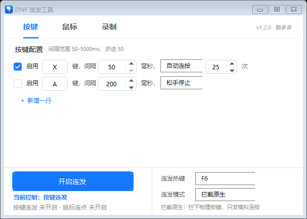
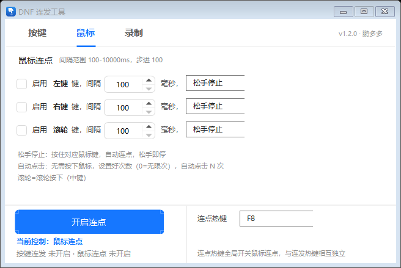
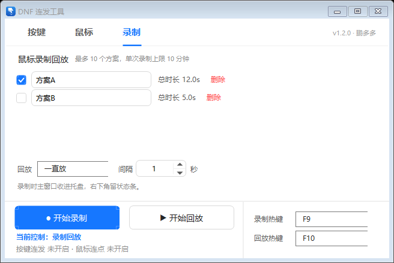

# DNF 连发工具

一个轻量的 Windows 桌面连发（按键重复触发）工具，使用 C# / .NET 8 WinForms 编写，单文件 EXE、开箱即用、内存占用低。三页签：**按键连发 / 鼠标连点 / 轨迹录制与回放**。

| 按键连发 | 鼠标连点 | 轨迹录制与回放 |
| --- | --- | --- |
|  |  |  |

## 功能特性

- **多键连发配置**：最多 5 行按键配置（默认 X、A 两行），每行可独立设置
  - 键名（支持 `A-Z`、`0-9`，以及小键盘数字 `N0`–`N9`：在输入框里直接按小键盘即可）
  - 触发间隔（毫秒，步进 50，范围 50–5000）
  - 停止条件：**松手停止**（默认，按住才连发）/ **自动连按**（开启后无需按住，`0` 表示无限次，可设 0–99999 次，步进 1，数值框后带「次」）
  - 启用开关（Checkbox）：勾选了就必须填键名，空键名或两行同键会拒绝开启并提示
- **鼠标连点**（v1.1.0 新增，v1.2.0 补充滚轮与自动点击）：左键 / 右键 / 滚轮（滚轮按下，即中键）三行，各自独立配置
  - 每键独立设置间隔（毫秒，默认 300，步进 100，范围 100–10000）
  - 停止条件：**松手停止**（默认，按住对应鼠标键才连点，松开即停）/ **自动点击**（开启后无需按住，`0` 表示一直点，可设 1–99999 次，步进 1）
  - 触发时拦截原生点击、由引擎统一注入，避免重复点击（自动点击行不拦截物理点击）
- **鼠标轨迹录制**（v1.2.0 新增）：`F9` 或录制页按钮开始/结束录制，主窗口自动收进托盘，屏幕右下角留一条可拖动的状态条（红点 + 计时 + ■ 停止）
  - 方案上限 10 个，列表内单选、行内改名（名称框固定 200px、最多 15 字符）、一键删除；行内跟在名称后面显示「总时长 12.4s」，删除紧跟在时长之后；单次录制上限 10 分钟，触顶自动停
  - 只录物理鼠标（左/右/中键 + 移动），程序自己注入的事件会被过滤；点状态条、拖状态条都不会录进轨迹
  - 方案存在独立文件 `recordings.json`，与 `config.json` 分开（避免每次勾选配置都重写大文件）
- **轨迹回放**（v1.2.0 新增）：选中一个方案后点左下角的「▶ 开始回放」（与「● 开始录制」并排、等宽）或按 `F10`，按录制时的时间轴重放光标移动与点击
  - 三种模式：**回放 N 次**（1–9999）/ **一直放**（默认）/ **定时 N 分钟**（1–600，到点即停，允许截断在半轮）
  - **回放间隔**：两轮之间等多久，默认 `1` 秒，可设 `0–999999` 秒，步进 1；`0` = 轮尾直接接轮头
  - 按 60fps 节奏重放：慢速大跨度移动自动按 16ms 补中间点，点击按下/抬起至少保持 20ms
  - **回放状态条**：开跑后右下角出现只读状态条，实时显示「回放中 · 方案A · 第 2/5 次 · mm:ss.d」，窗口收进托盘也能看清进度；整条**鼠标穿透**（轨迹经过它不会吃掉点击、也不会误触停止），要停按 `F10` 或托盘菜单
  - 停止（按钮或 `F10`）立即生效，并补发所有处于按下状态的鼠标键，不会卡键
  - 坐标按虚拟桌面归一化注入，多屏（含负坐标）与高 DPI 下与录制位置一致；录制后换过分辨率会提示可能有偏移
  - 若注入被系统拦截（未以管理员运行、目标程序权限更高），状态栏与 `error.log` 会给出提示
- **四个热键独立开关**：连发 `F6`、连点 `F8`、录制 `F9`、回放 `F10`，均在下方卡片中随当前 Tab 编辑，可同时生效；均按一下开启、再按一下关闭
- **两种连发模式**
  - `B 拦截原生`：拦截键盘原生输入，由程序接管连发（推荐游戏内使用）
  - `A 保留原生叠加`：保留原生按键，程序叠加模拟按键
- **独立双引擎**：按键连发与鼠标连点各自独立运行、互不冲突，可同时开启；主按钮跟随当前 Tab 控制对应引擎，并有「当前控制」标识提示
- **托盘运行**：开启后自动最小化到托盘，左键点击图标唤出窗口，右键菜单可开始/停止录制与回放、退出；悬停图标即可看到当前状态（运行中 / 录制中 / 回放中第几次）
- **关闭确认**：点窗口右上角 X（或 Alt+F4）会先问一句「最小化到托盘 / 退出程序」，选最小化则程序继续在后台跑；托盘右键「退出程序」可直接退出
- **配置持久化**：所有配置自动保存到 `config.json`，下次启动自动加载（默认与 EXE 同目录；若目录无写入权限，自动改用 `%APPDATA%\DnfAutoFire`）
- **错误日志**：EXE 同目录的 `error.log`，记录异常与关键操作（保留最近 200 行）

## 使用说明

1. 双击运行 `dnf-autofire.exe`（无需安装；程序以**管理员权限**运行，会弹出 UAC 确认框——DNF 由 TenProtect 保护以高权限运行，Windows UIPI 会丢弃低权限进程注入的按键，只有管理员运行连发注入才能到达游戏）
2. 在「按键」页配置目标键、间隔毫秒与停止条件，勾选需要连发的行
3. 点击左下角「开启连发」按钮（或按热键 `F6`）——「松手停止」的行按住键才连发；「自动连按」的行开启后不用按任何键，次数跑完会自动停（全部是自动连按行时，整体自动关回停止态）
4. 需要鼠标连点时切到「鼠标」页，配置间隔与停止条件、勾选启用，点击「开启连点」；「松手停止」的行**按住对应鼠标键即连点，松开即停**，「自动点击」的行开启后不用按任何键，次数跑完自动停（全部是自动点击行时，整体自动关回停止态）
5. 开启后窗口自动最小化到托盘，按 `F6`/`F8` 或点击托盘图标可随时关闭对应的连发/连点
6. 需要录轨迹时切到「录制」页点「● 开始录制」（或按 `F9`）：主窗口收进托盘，右下角出现状态条，正常操作鼠标即可；结束点状态条的 ■、再按 `F9` 或托盘菜单「停止录制」，方案会自动命名保存
7. 回放：在「录制」页的列表里勾选一个方案，选好模式（回放 N 次 / 一直放 / 定时 N 分钟）与回放间隔，点左下角的「▶ 开始回放」（和「开始录制」并排）或按 `F10`；主窗口自动收进托盘，右下角状态条显示当前是第几次，把游戏切到前台即可，再按 `F10` 立刻停
8. 修改任意配置（键名、间隔、勾选、热键、模式、连点参数、回放模式与间隔）后自动保存到 `config.json` 并即时生效，无需手动保存
9. 关闭窗口：点 X 会问「最小化到托盘还是退出」，选最小化则程序继续在后台运行（连发/连点/录制回放不中断）；确实要退出可选「退出程序」，或直接右键托盘图标点「退出程序」

> 回放时屏幕右下角的状态条（只读、鼠标穿透，轨迹点过去也不受影响）：
>
> 

> 注意：任一引擎运行状态下，对应页面的配置区域会锁定，需先停止再编辑；两个引擎互不影响，可同时开启。

## 连发模式说明

| 模式 | 行为 | 适用场景 |
| --- | --- | --- |
| 拦截原生（默认，配置里记作 `B`） | 拦截键盘原生输入，由程序按设定间隔重复发送扫描码 | 游戏内使用，避免原生重复干扰 |
| 保留原生（配置里记作 `A`） | 原生按键正常生效，程序在其基础上叠加模拟按键 | 需要保留系统级按键行为的场景 |

> 注意：「拦截原生」为**全局拦截**——连发开启期间，在系统任何位置（包括聊天窗口等游戏外场景）都无法正常输入目标键，如需临时输入请先按热键关闭连发。

> 间隔下限说明：DNF 这类游戏按帧（60fps≈16.7ms）轮询键盘状态、以「上帧未按下→本帧按下」的边沿触发攻击，按住不放只算一次，按下/抬起窗口短于 1 帧会被整段错过。因此引擎强制「按下保持 ≥20ms、抬起 ≥20ms」，**间隔范围 50–5000ms（约 20 次/秒）**——20 次/秒已接近 60 帧游戏边沿检测的物理极限，并非工具限制。

## 热键说明

- 连发热键（默认 `F6`）：全局开关**按键连发**；连点热键（默认 `F8`）：全局开关**鼠标连点**；录制热键（默认 `F9`）与回放热键（默认 `F10`）：全局开始/停止**录制**与**回放**
- 四个热键同时全局生效（即使窗口隐藏在托盘也可触发）；在下方卡片中随当前 Tab 编辑对应热键
- 单键开关：按一次开启，再按一次关闭
- 若热键被其他程序占用，启动时会在状态栏与 `error.log` 中给出警告，此时仍可通过界面按钮开关
- 四个热键互斥：某个键已经被别的功能占用时，在下拉列表里**置灰不可选**（比如连发选了 `F6`，鼠标页、录制页的 `F6` 就是灰的，鼠标移上去是「禁止」光标）；万一硬选到重复的（方向键、旧配置），会提示「F7」已被「录制热键」占用，无法选择并退回原值
- 四个热键配成同一个键时只注册一次，状态栏会直接指出重复的是哪两项（如「热键重复 F9（连发/录制）」），改掉重复项即可

## 数据文件

| 文件 | 位置 | 说明 |
| --- | --- | --- |
| `config.json` | EXE 同目录（无写权限时 `%APPDATA%\DnfAutoFire\`） | 按键、鼠标、热键、模式、回放模式等全部设置 |
| `recordings.json` | 同上 | 录制方案（含轨迹点），最多 10 个方案；与配置文件分开，避免改设置时重写大文件 |
| `error.log` | 同上 | 异常与关键操作日志，只保留最近 200 行 |

- 两个 JSON 都可以手工编辑，程序下次启动读取；`recordings.json` 解析失败时**只回退空列表、不会覆盖原文件**
- 想清空方案直接删 `recordings.json`；想备份就把两个文件一起拷走

## 配置文件示例（config.json）

```json
{
  "ConfigVersion": "1.2.0",
  "Keys": [
    { "Key": "X", "IntervalMs": 50, "StopMode": "hold", "StopValue": 0, "Enabled": true },
    { "Key": "A", "IntervalMs": 100, "StopMode": "auto", "StopValue": 200, "Enabled": false }
  ],
  "MouseClicks": [
    { "Button": "L", "IntervalMs": 300, "StopMode": "infinite", "StopValue": 1, "Enabled": false },
    { "Button": "R", "IntervalMs": 300, "StopMode": "auto", "StopValue": 50, "Enabled": true },
    { "Button": "M", "IntervalMs": 100, "StopMode": "infinite", "StopValue": 1, "Enabled": false }
  ],
  "StartHotkey": "F6",
  "MouseStartHotkey": "F8",
  "RecordHotkey": "F9",
  "PlaybackHotkey": "F10",
  "PlayMode": "infinite",
  "PlayValue": 1,
  "PlayGapSec": 1,
  "Mode": "B"
}
```

- `Keys.StopMode`：`hold`=松手停止（默认）/ `auto`=自动连按；`StopValue` 为自动连按的次数（`0` = 无限）
- `MouseClicks.Button`：`L`=左键 / `R`=右键 / `M`=滚轮（按下）
- `MouseClicks.StopMode`：`infinite`=松手停止（默认）/ `auto`=自动点击；`StopValue` 为自动点击的次数（`0` = 一直点，旧版 `count` 读入后按自动点击处理）
- `PlayMode`：`count`=回放 N 次 / `infinite`=一直放 / `duration`=定时 N 分钟；`PlayValue` 为对应的次数或分钟数
- `PlayGapSec`：两轮回放之间的等待秒数（`0` = 不等待，默认 `1`，上限 999999）
- `ConfigVersion`：配置结构版本，等于写盘时的程序版本。加载时**不做整份重置**，而是逐字段合并：
  - 认识的字段、值也合法 → 原样保留
  - 文件里缺的字段（新增项）→ 用默认值补上
  - 已废弃的字段（如早先的 `PlayGapMs`）→ 丢弃，回写后从文件里消失；`PlayGapMs` 会先换算成秒写进 `PlayGapSec`
  - 越界的值（如间隔 99999、热键写成 `F13`）→ 钳到允许范围或回落默认值
  - 每次启动都会把合并结果写回文件，并把 `ConfigVersion` 更新为当前程序版本
- 配置文件默认与 EXE 同目录；若 EXE 所在目录无写入权限，则使用 `%APPDATA%\DnfAutoFire\config.json`
- 文件完全无法解析时以默认配置运行（文件保留原样以便排查），并记录到 `error.log`；下次保存配置时覆盖

## 环境要求

- Windows 10 / 11（x64）

## 下载

前往 [Releases](https://github.com/wp993080086/dnf-autofire/releases) 下载最新版 `dnf-autofire.exe`，单文件、无需安装。

推送 `v` 开头的 tag（如 `v1.0.0-beta`、`v1.2.0`）会自动触发 GitHub Actions 构建并发布到 Releases。

## 从源码构建

需要 [.NET 8 SDK](https://dotnet.microsoft.com/download/dotnet/8.0)：

```bash
dotnet publish -c Release -r win-x64 ^
  -p:PublishSingleFile=true ^
  -p:SelfContained=true ^
  -p:IncludeNativeLibrariesForSelfExtract=true ^
  -p:EnableCompressionInSingleFile=true
```

产物位于 `bin/Release/net8.0-windows/win-x64/publish/dnf-autofire.exe`，为自包含单文件，目标机器无需安装 .NET 运行时。

## 调试参数

| 参数 | 说明 |
| --- | --- |
| `--screenshot <path.png> [n] [mouse\|record]` | 离屏渲染主界面并保存 PNG（可选拦截参数：额外新增 n 行；`mouse`/`record` 切到对应 Tab） |
| `--uitest <prefix>` | 窗口可见状态下切换按钮运行态/停止态，用 PrintWindow 抓图验证自绘控件重绘 |
| `--mouselayout` | 打印鼠标页每行控件的实际坐标与尺寸，核对行内排布 |
| `--mousetest <秒>` | 按当前配置开启鼠标连点，数秒后关闭退出（配 `DNF_DRYRUN=1` 只跑调度、不注入点击） |
| `--recordtest <秒> <png>` | 自动开始录制、抓一张悬浮条截图、到时停止并退出（验证录制链路） |
| `--playtest <方案名> <值> [count\|infinite\|duration] [最长秒数] [png]` | 按指定模式开启回放，跑完/到点即退出（配 `DNF_DRYRUN=1` 只跑时间轴、不注入鼠标；给 `png` 则 3 秒后抓一张回放状态条） |
| `--playoverlaytest <png> [第几次] [总次数]` | 离屏渲染回放状态条并保存 PNG，同时打印窗口扩展样式（确认鼠标穿透确实生效） |
| `--seltest` | 模拟点击第二个方案，验证单选互斥不会无限递归（需要 `recordings.json` 里至少 2 个方案） |
| `--hotkeytest` | 打印四个热键在当前页的置灰项，并硬选一个被占用的键，确认会被退回原值 |
| `--cursortest` | 把光标依次移到按钮/复选框/输入框/下拉/删除/禁用控件上，打印当前光标形状（Hand / IBeam / No / Default） |
| `--movetest <x> <y>` | 注入一次绝对定位并回报光标实际落点与 `SendInput` 返回值，用于确认当前环境允许注入 |
| `--closetest <png> [busy]` | 离屏渲染「关闭还是最小化到托盘」询问框并保存 PNG（`busy` 展示有任务在运行时的文案） |
| `--xclosetest <前缀>` | 自动模拟点 X：询问框出现 → 选最小化 → 再点 X → 选退出，日志记录各步结果 |

## 技术实现

- **键盘钩子**：`SetWindowsHookEx(WH_KEYBOARD_LL)` 低级钩子，过滤自身注入事件防止自我触发
- **鼠标钩子**：`SetWindowsHookEx(WH_MOUSE_LL)` 低级钩子（`LLMHF_INJECTED` 过滤自身注入的点击），触发时拦截原生点击由引擎统一注入
- **按键模拟**：`SendInput` 扫描码方式发送（键盘）/ `MOUSEEVENTF_*` 标志（鼠标），兼容性最好
- **轨迹录制**：`WH_MOUSE_LL` 回调里只做「过滤 + 预分配列表 Add」，不写文件、不碰 UI，避免回调超时被系统静默摘钩；悬浮条矩形整块排除、两级时间/位移降噪
- **轨迹回放**：独立高精度线程按录制时间轴重放（`timeBeginPeriod(1)` + 1ms 轮询）；定位用 `MOUSEEVENTF_ABSOLUTE | VIRTUALDESK` 归一化到虚拟桌面，多屏负坐标与 125%/150% 缩放都和录制一致；相邻移动间隔 ≥32ms 且位移 ≥4px 时按 16ms 补点，点击按下/抬起至少保持 20ms；回放状态条挂 `WS_EX_TRANSPARENT | WS_EX_NOACTIVATE`，只显示不接鼠标，轨迹点过去也不会被它吞掉
- **全局热键**：`RegisterHotKey` + `WM_HOTKEY` 消息
- **自绘 UI**：全部控件（按钮、输入框、数字框、下拉框、复选框、滚动条、托盘）基于 GDI+ 手写

## 免责声明

本工具仅供学习交流与个人效率用途，请遵守目标软件的用户协议与相关法律法规，使用本工具产生的一切后果由使用者自行承担。

## 更新日志

版本变更历史见 [CHANGELOG.md](CHANGELOG.md)（遵循 [Keep a Changelog](https://keepachangelog.com/zh-CN/1.1.0/) 规范）。

## 开源许可

本项目基于 [MIT License](LICENSE) 开源。
