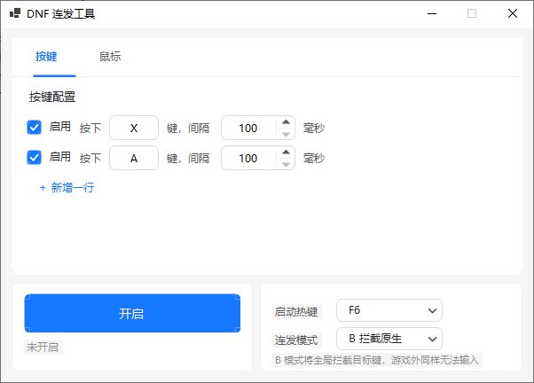

# DNF 连发工具

一个轻量的 Windows 桌面连发（按键重复触发）工具，使用 C# / .NET 8 WinForms 编写，单文件 EXE、开箱即用、内存占用低。



## 功能特性

- **多键连发配置**：最多 5 行按键配置（默认 X、A 两行），每行可独立设置
  - 键名（仅支持 `A-Z`、`0-9`）
  - 触发间隔（毫秒，步进 1，范围 50–5000）
  - 启用开关（Checkbox）
- **鼠标连点**（v1.1.0 新增）：按住鼠标左键/右键时自动连点，松开即停
  - 每键独立设置间隔（毫秒，范围 50–5000）
  - 停止条件二选一：点 N 次 / 松手停止（默认，即不手动关闭不停止）
  - 触发时拦截原生点击、由引擎统一注入，避免重复点击
- **双热键独立开关**：连发热键（默认 `F6`）开关按键连发、连点热键（默认 `F8`）开关鼠标连点，均在下方卡片中随当前 Tab 编辑，可同时生效
- **两种连发模式**
  - `B 拦截原生`：拦截键盘原生输入，由程序接管连发（推荐游戏内使用）
  - `A 保留原生叠加`：保留原生按键，程序叠加模拟按键
- **独立双开关**：按键连发与鼠标连点各自独立运行、互不冲突，可同时开启；主按钮跟随当前 Tab 控制对应引擎
- **单键开关热键**：默认 `F6`，按一下开启、再按一下关闭，可在下拉框中更换
- **托盘运行**：开启后自动最小化到托盘，左键点击图标唤出窗口，右键菜单可退出
- **配置持久化**：所有配置自动保存到 `config.json`，下次启动自动加载（默认与 EXE 同目录；若目录无写入权限，自动改用 `%APPDATA%\DnfAutoFire`）
- **错误日志**：EXE 同目录的 `error.log`，记录异常与关键操作（保留最近 200 行）

## 使用说明

1. 双击运行 `dnf-autofire.exe`（无需安装；程序以**管理员权限**运行，会弹出 UAC 确认框——DNF 由 TenProtect 保护以高权限运行，Windows UIPI 会丢弃低权限进程注入的按键，只有管理员运行连发注入才能到达游戏）
2. 在「按键」页配置目标键、间隔毫秒，勾选需要连发的行
3. 点击左下角「开启连发」按钮（或按热键 `F6`）
4. 需要鼠标连点时切到「鼠标」页，配置间隔与停止条件、勾选启用，点击「开启连点」；此后**按住对应鼠标键即自动连点，松开即停**
5. 开启后窗口自动最小化到托盘，按 `F6` 或点击托盘图标可随时停止连发；连点通过窗口按钮关闭
6. 修改任意配置（键名、间隔、勾选、热键、模式、连点参数）后自动保存到 `config.json` 并即时生效，无需手动保存

> 注意：任一引擎运行状态下，对应页面的配置区域会锁定，需先停止再编辑；两个引擎互不影响，可同时开启。

## 连发模式说明

| 模式 | 行为 | 适用场景 |
| --- | --- | --- |
| B 拦截原生 | 拦截键盘原生输入，由程序按设定间隔重复发送扫描码 | 游戏内使用，避免原生重复干扰 |
| A 保留原生叠加 | 原生按键正常生效，程序在其基础上叠加模拟按键 | 需要保留系统级按键行为的场景 |

> 注意：B 模式为**全局拦截**——连发开启期间，在系统任何位置（包括聊天窗口等游戏外场景）都无法正常输入目标键，如需临时输入请先按热键关闭连发。

> 间隔下限说明：DNF 这类游戏按帧（60fps≈16.7ms）轮询键盘状态、以「上帧未按下→本帧按下」的边沿触发攻击，按住不放只算一次，按下/抬起窗口短于 1 帧会被整段错过。因此引擎强制「按下保持 ≥20ms、抬起 ≥20ms」，**间隔范围 50–5000ms（约 20 次/秒）**——20 次/秒已接近 60 帧游戏边沿检测的物理极限，并非工具限制。

## 热键说明

- 连发热键（默认 `F6`）：全局开关**按键连发**；连点热键（默认 `F8`）：全局开关**鼠标连点**
- 两个热键同时全局生效（即使窗口隐藏在托盘也可触发）；在下方卡片中随当前 Tab 编辑对应热键
- 单键开关：按一次开启，再按一次关闭
- 若热键被其他程序占用，启动时会在状态栏与 `error.log` 中给出警告，此时仍可通过界面按钮开关

## 配置文件示例（config.json）

```json
{
  "Keys": [
    { "Key": "X", "IntervalMs": 100, "Enabled": true },
    { "Key": "A", "IntervalMs": 100, "Enabled": true }
  ],
  "MouseClicks": [
    { "Button": "L", "IntervalMs": 100, "StopMode": "infinite", "StopValue": 50, "Enabled": false },
    { "Button": "R", "IntervalMs": 100, "StopMode": "count", "StopValue": 50, "Enabled": true }
  ],
  "StartHotkey": "F6",
  "MouseStartHotkey": "F8",
  "Mode": "B"
}
```

- `MouseClicks.StopMode`：`count`=点 N 次 / `infinite`=松手停止（默认）；`StopValue` 为点 N 次的次数
- 配置文件默认与 EXE 同目录；若 EXE 所在目录无写入权限，则使用 `%APPDATA%\DnfAutoFire\config.json`
- 文件损坏时自动回退默认配置，并记录到 `error.log`

## 环境要求

- Windows 10 / 11（x64）

## 下载

前往 [Releases](https://github.com/wp993080086/dnf-autofire/releases) 下载最新版 `dnf-autofire-v*.exe`，单文件、无需安装。

推送 `v` 开头的 tag（如 `v1.0.0-beta`、`v1.1.0`）会自动触发 GitHub Actions 构建并发布到 Releases。

## 从源码构建

需要 [.NET 8 SDK](https://dotnet.microsoft.com/download/dotnet/8.0)：

```bash
dotnet publish -c Release -r win-x64 ^
  -p:PublishSingleFile=true ^
  -p:SelfContained=true ^
  -p:IncludeNativeLibrariesForSelfExtract=true ^
  -p:EnableCompressionInSingleFile=true
```

产物位于 `bin/Release/net8.0-windows/win-x64/publish/dnf-autofire.exe`，为自包含单文件，目标机器无需安装 .NET 运行时。

## 调试参数

| 参数 | 说明 |
| --- | --- |
| `--screenshot <path.png> [n] [mouse]` | 离屏渲染主界面并保存 PNG（可选拦截参数：额外新增 n 行；`mouse` 切到鼠标 Tab） |
| `--uitest <prefix>` | 窗口可见状态下切换按钮运行态/停止态，用 PrintWindow 抓图验证自绘控件重绘 |

## 技术实现

- **键盘钩子**：`SetWindowsHookEx(WH_KEYBOARD_LL)` 低级钩子，过滤自身注入事件防止自我触发
- **鼠标钩子**：`SetWindowsHookEx(WH_MOUSE_LL)` 低级钩子（`LLMHF_INJECTED` 过滤自身注入的点击），触发时拦截原生点击由引擎统一注入
- **按键模拟**：`SendInput` 扫描码方式发送（键盘）/ `MOUSEEVENTF_*` 标志（鼠标），兼容性最好
- **全局热键**：`RegisterHotKey` + `WM_HOTKEY` 消息
- **自绘 UI**：全部控件（按钮、输入框、数字框、下拉框、复选框、滚动条、托盘）基于 GDI+ 手写

## 免责声明

本工具仅供学习交流与个人效率用途，请遵守目标软件的用户协议与相关法律法规，使用本工具产生的一切后果由使用者自行承担。

## 开源许可

本项目基于 [MIT License](LICENSE) 开源。
