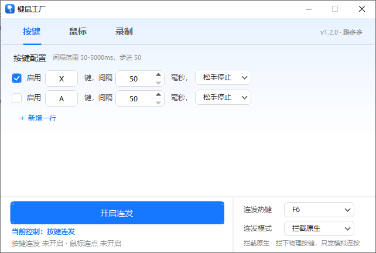
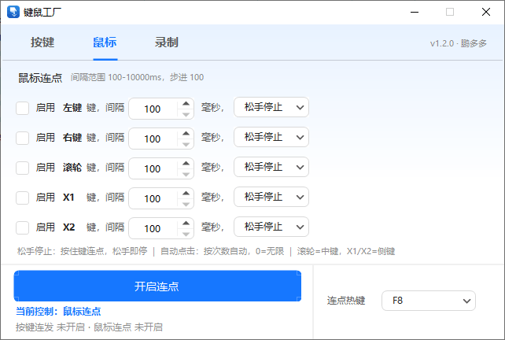
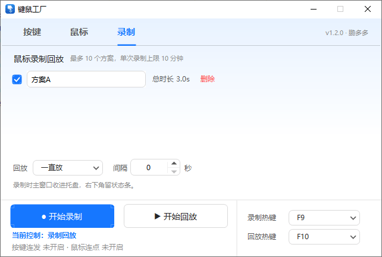
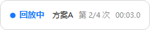

# 键鼠工厂

一个轻量的 Windows 桌面工具，支持按键连点、鼠标连点、鼠标轨迹录制回放。使用 C# / .NET 8 WinForms 编写，单文件 EXE、开箱即用、内存占用低。三页签：**连按 / 鼠标连点 / 轨迹录制与回放**。

| 连按 | 鼠标连点 | 轨迹录制与回放 |
| --- | --- | --- |
|  |  |  |

## 功能特性

- **多键连按配置**：最多 5 行按键配置（默认 X、A 两行），每行可独立设置
  - 键名：在输入框里**直接按目标键**即可，支持 `A-Z`、`0-9`、空格、符号键与小键盘 `N0`–`N9`（完整清单与取舍理由见[支持的键位](#支持的键位)）
  - 触发间隔（毫秒，步进 50，范围 50–5000）
  - 停止条件：**松手停止**（默认，按住才连按）/ **自动连按**（开启后无需按住，`0` 表示无限次，可设 0–99999 次，步进 1，数值框后带「次」）
  - 启用开关（Checkbox）：勾选了就必须填键名，空键名或两行同键会拒绝开启并提示
- **鼠标连点**：左键 / 右键 / 滚轮（滚轮按下，即中键）/ `X1` / `X2`（前进后退侧键）五行，各自独立配置
  - 每键独立设置间隔（毫秒，默认 300，步进 100，范围 100–10000）
  - 停止条件：**松手停止**（默认，按住对应鼠标键才连点，松开即停）/ **自动点击**（开启后无需按住，`0` 表示一直点，可设 1–99999 次，步进 1）
  - 触发时拦截原生点击、由引擎统一注入，避免重复点击（自动点击行不拦截物理点击）
- **鼠标轨迹录制**：`F9` 或录制页按钮开始/结束录制，主窗口自动收进托盘，屏幕右下角留一条可拖动的状态条（红点 + 计时 + ■ 停止）
  - 方案上限 10 个，列表内单选、行内改名（名称框固定 200px、最多 15 字符）、一键删除；行内跟在名称后面显示「总时长 12.4s」，删除紧跟在时长之后；单次录制上限 10 分钟，触顶自动停
  - 只录物理鼠标（左/右/中键 + 移动），程序自己注入的事件会被过滤；点状态条、拖状态条都不会录进轨迹
  - 方案存在独立文件 `recordings.json`，与 `config.json` 分开（避免每次勾选配置都重写大文件）
- **轨迹回放**：选中一个方案后点左下角的「▶ 开始回放」（与「● 开始录制」并排、等宽）或按 `F10`，按录制时的时间轴重放光标移动与点击
  - 三种模式：**回放 N 次**（1–9999）/ **一直放**（默认）/ **定时 N 分钟**（1–600，到点即停，允许截断在半轮）
  - **回放间隔**：两轮之间等多久，默认 `1` 秒，可设 `0–999999` 秒，步进 1；`0` = 轮尾直接接轮头
  - 按 60fps 节奏重放：慢速大跨度移动自动按 16ms 补中间点，点击按下/抬起至少保持 20ms
  - **回放状态条**：开跑后右下角出现只读状态条，实时显示「回放中 · 方案A · 第 2/5 次 · mm:ss.d」，窗口收进托盘也能看清进度；整条**鼠标穿透**（轨迹经过它不会吃掉点击、也不会误触停止），要停按 `F10` 或托盘菜单
  - 停止（按钮或 `F10`）立即生效，并补发所有处于按下状态的鼠标键，不会卡键
  - 坐标按虚拟桌面归一化注入，多屏（含负坐标）与高 DPI 下与录制位置一致；录制后换过分辨率会提示可能有偏移
  - 若注入被系统拦截（未以管理员运行、目标程序权限更高），状态栏与 `error.log` 会给出提示
- **四个热键独立开关**：连按 `F6`、连点 `F8`、录制 `F9`、回放 `F10`，均在下方卡片中随当前 Tab 编辑，可同时生效；均按一下开启、再按一下关闭
- **两种连按模式**：`B 拦截原生`（拦截键盘原生输入，由程序接管连按，推荐游戏内使用）/ `A 保留原生叠加`（保留原生按键，程序叠加模拟按键）
- **防打字干扰**（按键页）：默认开启，两个来源任一成立就自动暂停连按、放行物理键——① **焦点离开游戏**（游戏窗口还在、只是失焦也算，切回来自动恢复）；② **聊天键**（默认 `ENTER`，可改成 `ESC`/`TAB` 等，按下切换打字态）。这样在游戏外打字、或游戏内开聊天框打字时都不会被连按吞键；聊天键编辑框就在主按钮右侧，勾选取消则回到"全局拦截"的原行为
- **独立双引擎**：连按与鼠标连点各自独立运行、互不冲突，可同时开启；主按钮跟随当前 Tab 控制对应引擎，并有「当前控制」标识提示
- **托盘运行**：开启后自动最小化到托盘，左键点击图标唤出窗口，右键菜单只有「显示窗口 / 打开日志 / 退出程序」；录制与回放请用热键或状态条上的按钮；悬停图标即可看到当前状态（运行中 / 录制中 / 回放中第几次）
- **关闭确认**：点窗口右上角 X（或 Alt+F4）会先问一句「最小化到托盘 / 退出程序」，选最小化则程序继续在后台跑；托盘右键「退出程序」可直接退出
- **配置持久化**：所有配置自动保存到 `config.json`，下次启动自动加载（默认与 EXE 同目录；若目录无写入权限，自动改用 `%APPDATA%\KeyMouseFactory`）。改动立即在内存生效，写盘做 400ms 防抖——连续点箭头只落一次盘，关闭窗口时强制落盘
- **错误日志**：EXE 同目录的 `error.log`，记录异常与关键操作（保留最近 200 行）

## 使用说明

1. 双击运行 `key-mouse-factory.exe`（无需安装；程序以**管理员权限**运行，会弹出 UAC 确认框——游戏由反作弊保护以高权限运行时，Windows UIPI 会丢弃低权限进程注入的按键，只有管理员运行连按注入才能到达游戏）
2. 在「按键」页配置目标键、间隔毫秒与停止条件，勾选需要连按的行
3. 主按钮右侧的「防打字干扰」默认勾选，聊天键默认 `ENTER`（点框后直接按想要键即可改，支持 `ENTER`/`ESC`/`TAB` 等）：开启连按后，切到别的软件打字会自动暂停连按、切回游戏自动恢复；游戏内开聊天框时按一下聊天键进入打字态、打完再按一下退出，期间连按暂停、打字正常。若不想要这个功能，取消勾选即可回到全局拦截的原行为
4. 点击左下角「开启连按」按钮（或按热键 `F6`）——「松手停止」的行按住键才连按；「自动连按」的行开启后不用按任何键，次数跑完会自动停（全部是自动连按行时，整体自动关回停止态）
5. 需要鼠标连点时切到「鼠标」页，配置间隔与停止条件、勾选启用，点击「开启连点」；「松手停止」的行**按住对应鼠标键即连点，松开即停**，「自动点击」的行开启后不用按任何键，次数跑完自动停（全部是自动点击行时，整体自动关回停止态）
6. 开启后窗口自动最小化到托盘，按 `F6`/`F8` 或点击托盘图标可随时关闭对应的连按/连点
7. 需要录轨迹时切到「录制」页点「● 开始录制」（或按 `F9`）：主窗口收进托盘，右下角出现状态条，正常操作鼠标即可；结束点状态条的 ■ 或再按 `F9`，方案会自动命名保存
8. 回放：在「录制」页的列表里勾选一个方案，选好模式（回放 N 次 / 一直放 / 定时 N 分钟）与回放间隔，点左下角的「▶ 开始回放」（和「开始录制」并排）或按 `F10`；主窗口自动收进托盘，右下角状态条显示当前是第几次，把游戏切到前台即可，再按 `F10` 立刻停
9. 修改任意配置（键名、间隔、勾选、热键、模式、防打字干扰、连点参数、回放模式与间隔）后自动保存到 `config.json` 并即时生效，无需手动保存
10. 关闭窗口：点 X 会问「最小化到托盘还是退出」，选最小化则程序继续在后台运行（连按/连点/录制回放不中断）；确实要退出可选「退出程序」，或直接右键托盘图标点「退出程序」

> 回放时屏幕右下角的状态条（只读、鼠标穿透，轨迹点过去也不受影响）：
>
> 

> 注意：任一引擎运行状态下，对应页面的配置区域会锁定，需先停止再编辑；两个引擎互不影响，可同时开启。

## 支持的键位

键名框里**直接按目标键**就会填入对应键名，不用查表；也可以手工输入或粘贴（粘贴非法键名会被清空并提示）。

| 类别 | 键名 | 说明 |
| --- | --- | --- |
| 字母 / 数字 | `A`–`Z`、`0`–`9` | 单字符 |
| 小键盘数字 | `N0`–`N9` | 与主键盘数字分开算，按小键盘直接得到 `N5` |
| 空格 | `SPC` | |
| 符号键 | `;` `=` `,` `-` `.` `/` `` ` `` `[` `\` `]` `'` | 按物理键位记录，不受键盘布局影响；`-` 是主键盘那个减号 |

范围只到「游戏里会当技能键用」的这些，其余一律不支持：`F1`–`F12`、方向键、`TAB`/`ENT`/`ESC`/`BS`/`HOME`/`END`/`PGUP`/`PGDN`、`Delete`/`Insert`、修饰键（`Shift`/`Ctrl`/`Alt`）、小键盘的 `/` `*` `-` `+` `.`、`CapsLock` 与 `Win` 键。

这样取舍的原因：

- **F 键让给热键**：四个热键就是 `F1`–`F12`，目标键若也能选 F 键，按下去只会被系统截走当热键用，连按收不到那次按下；
- **方向键与编辑键在游戏里没有连按价值**，留着反而会把文本框的光标移动、退格删除、Tab 切换焦点一并吃掉；
- **修饰键**连按没有意义，而「拦截原生」模式会把系统的 Shift / Ctrl 一起拦掉，大写与组合键会全部失效。

`Delete` 在键名框里用于清空当前行键名，因此不作为目标键。

## 连按模式说明

| 模式 | 行为 | 适用场景 |
| --- | --- | --- |
| 拦截原生（默认，配置里记作 `B`） | 拦截键盘原生输入，由程序按设定间隔重复发送扫描码 | 游戏内使用，避免原生重复干扰 |
| 保留原生（配置里记作 `A`） | 原生按键正常生效，程序在其基础上叠加模拟按键 | 需要保留系统级按键行为的场景 |

> 注意：未开启「防打字干扰」时，「拦截原生」为**全局拦截**——连按开启期间，在系统任何位置都无法正常输入目标键，需临时输入请先按热键关闭连按。开启「防打字干扰」（默认开）后：焦点离开游戏、或按下聊天键进入打字态时，连按会自动暂停并放行物理键，打字不受影响；焦点切回游戏或再按一次聊天键即恢复。

> 间隔下限说明：游戏按帧（60fps≈16.7ms）轮询键盘状态、以「上帧未按下→本帧按下」的边沿触发攻击，按住不放只算一次，按下/抬起窗口短于 1 帧会被整段错过。因此引擎强制「按下保持 ≥20ms、抬起 ≥20ms」，**间隔范围 50–5000ms（约 20 次/秒）**——20 次/秒已接近 60 帧游戏边沿检测的物理极限，并非工具限制。

## 热键说明

- 连按热键（默认 `F6`）：全局开关**连按**；连点热键（默认 `F8`）：全局开关**鼠标连点**；录制热键（默认 `F9`）与回放热键（默认 `F10`）：全局开始/停止**录制**与**回放**
- 四个热键同时全局生效（即使窗口隐藏在托盘也可触发）；在下方卡片中随当前 Tab 编辑对应热键
- 单键开关：按一次开启，再按一次关闭
- 若热键被其他程序占用，会按 `F1`→`F12` 顺序自动改用一个空闲键（跳过其它槽位正在用的键），状态栏、托盘气泡与 `error.log` 都会提示，并把新键**写回配置**；12 个全被占用时才退回只警告的状态，此时仍可通过界面按钮开关
- 四个热键互斥：某个键已经被别的功能占用时，在下拉列表里**置灰不可选**（比如连按选了 `F6`，鼠标页、录制页的 `F6` 就是灰的，鼠标移上去是「禁止」光标）；万一硬选到重复的（方向键、旧配置），会提示占用并退回原值
- 程序只允许一份实例运行。再次双击 exe 时不会弹「已经在运行」就退出，而是通知已运行的实例把窗口从托盘叫到前台

## 数据文件

| 文件 | 位置 | 说明 |
| --- | --- | --- |
| `config.json` | EXE 同目录（无写权限时 `%APPDATA%\KeyMouseFactory\`） | 按键、鼠标、热键、模式、回放模式等全部设置 |
| `recordings.json` | 同上 | 录制方案（含轨迹点），最多 10 个方案；与配置文件分开，避免改设置时重写大文件 |
| `error.log` | 同上 | 异常与关键操作日志，只保留最近 200 行；托盘菜单「打开日志」可直接用系统默认程序打开 |

字段含义、版本兼容与手工编辑说明见 [配置与数据文件](docs/CONFIG.md)；异常时弹窗、JSON 容错等细节也在该文档。

## 下载

前往 [Releases](https://github.com/wp993080086/key-mouse-factory/releases) 下载最新版 `key-mouse-factory.exe`，单文件、无需安装，目标机器无需预装 .NET 运行时。

## 文档索引

面向使用者：

- [更新日志](CHANGELOG.md)（遵循 [Keep a Changelog](https://keepachangelog.com/zh-CN/1.1.0/) 规范）

面向开发者：

- [技术实现](docs/ARCHITECTURE.md) —— 钩子、注入、调度、录制回放与自绘 UI 的实现方式
- [配置与数据文件](docs/CONFIG.md) —— `config.json` 字段、版本兼容、`recordings.json` 与日志
- [构建、测试与调试](docs/DEVELOPMENT.md) —— 源码构建、单元测试、Debug 专用调试参数
- [功能方案与落地记录](docs/PLAN.md) —— 功能方案的推演、实施计划与落地差异

## 免责声明

本工具仅供学习交流与个人效率用途，请遵守目标软件的用户协议与相关法律法规，使用本工具产生的一切后果由使用者自行承担。

## 开源许可

本项目基于 [MIT License](LICENSE) 开源。
