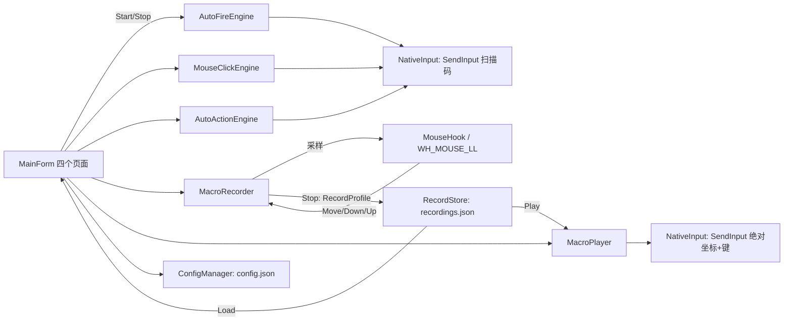
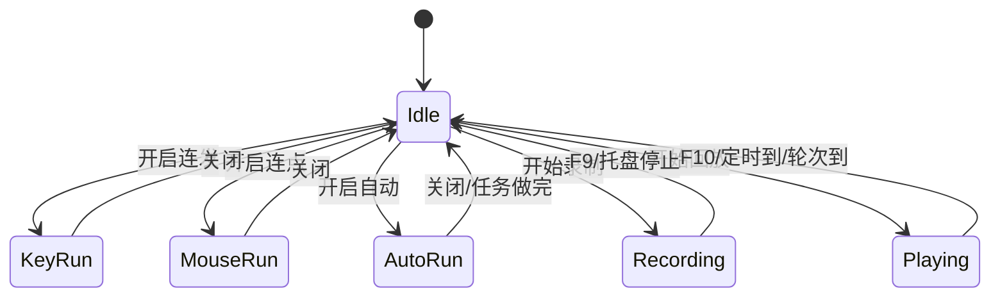

# v1.2.0 功能方案：自动执行 + 鼠标轨迹录制回放

> 状态：需求已定稿（第 13 节）　|　分支：`v-1.2.0`（基线 master `181c37d`）　|　文档位置：`docs/PLAN-v1.2.0.md`
>
> 进度：**P0a Tab 重构已落地**（按键 / 鼠标 / 录制 三个 Tab，录制页为占位），其余按第 10 节分阶段推进，每阶段可独立编译、独立验收。

---

## 1. 需求拆解

| 编号 | 需求原文要点 | 关键行为 | 与现有功能的关系 |
| --- | --- | --- | --- |
| R1 | 键盘自动按键：设置 1 个或多个按键 + 间隔毫秒；启动后按间隔按个不停，或按间隔按 N 次 | **定时触发**，不需要按住任何键 | 与"按键连发"同用 `SendInput` 扫描码路径，但触发模型不同 |
| R2 | 鼠标自动点击：左键 / 右键 / **中键** + 间隔毫秒；一直点或点 N 次 | **定时触发**，不需要按住鼠标 | 与"鼠标连点"同一个注入函数，需补中键常量 |
| R3 | 鼠标轨迹 + 点击录制，可存多个方案（方案A/方案B…）；回放可选一个方案，回放 N 次 / 一直 / 定时 N 分钟；开始与停止都支持快捷键 | **录制**（全局鼠标采样）→ **持久化** → **时间轴回放** + 循环/定时 | 全新能力，复用鼠标钩子与 `SendInput` |

三项都属于"全局钩子 + 定时注入"的一个家族，与现有两个引擎同源，架构上不需要推倒重来。

---

## 2. 可行性结论

**三项都可行，工作量集中在 R3。** 真正的难点不是"功能做不出来"，而是下面三件事，方案里必须正面处理：

1. **触发模型不一样，不能复用现有引擎。** 现有 `AutoFireEngine` / `MouseClickEngine` 的语义是"物理按住 → 引擎接管重复"。R1/R2 是"没人按键也要自己按"，是一个纯粹的定时器 + 注入器。硬塞进现有引擎会污染"按住"状态机，回归风险高。**结论：新增一个通用定时引擎，老引擎一行不动。**
2. **录制是高频事件源，低级钩子扛不住"重活"。** `WH_MOUSE_LL` 回调跑在安装钩子的线程（UI 线程），系统对回调有超时限制（`LowLevelHooksTimeout`，默认 300ms），超时会被**静默摘钩**。鼠标移动可达每秒数百次，回调里不能分配大对象、不能写文件、不能碰 UI。方案：回调里只做"距离/时间过滤 + 追加到预分配数组"，落盘放到停止录制时一次性做。
3. **回放的"坐标"有两层坑。** 一是 DPI 虚化（进程 SystemAware 时挂钩坐标与 `SendInput` 绝对坐标都是物理像素，必须保持一致）；二是多显示器虚拟桌面（含负坐标，必须用 `MOUSEEVENTF_VIRTUALDESK` + `SM_*VIRTUALSCREEN` 归一化）。

另外一个必须提前说清的预期管理：**轨迹回放能否在游戏内"生效"，取决于游戏怎么读鼠标。** DNF 的攻击靠键盘边沿触发（已有 40ms 下限结论），鼠标主要用于 UI 点击与少量拖拽；如果某个场景游戏走 Raw Input / DirectInput 读相对位移，注入的绝对坐标移动可能不被采信。这部分**只能真机验证，不能靠设计保证**，方案里会给降级路径。

---

## 3. 现状盘点与改造面

### 3.1 可直接复用的资产

| 资产 | 位置 | 复用方式 |
| --- | --- | --- |
| 扫描码注入 | `NativeInput.SendKey` / `TapKey` | 直接复用 |
| 鼠标键注入 | `NativeInput.SendMouseButton(bool left, bool up)` | 扩展为 `SendMouseButton(int button, bool up)` |
| 低级钩子骨架 | `KeyboardHook` / `MouseHook` | `MouseHook` 增加 Move 事件与中键 |
| 高精度调度 | `timeBeginPeriod(1)` + `Stopwatch` + `WorkerLoop` + `Sleep(1)` | 新引擎照抄这套骨架 |
| 自绘控件 | `AntButton / AntCheckBox / AntInput / AntNumber / AntSelect / FlatScrollBar` | 新页面全部复用，不新增控件类型 |
| 滚动容器 | `pnlContent + FlatScrollBar + WheelFilter` | 方案列表直接套用 |
| 配置 / 日志 / 托盘 / 热键 | `ConfigManager` / `Logger` / `NotifyIcon` / `RegisterHotKey` | 增量扩展 |

### 3.2 必须改的三处硬编码（P0 地基）

> ✅ 已在 `v-1.2.0` 分支落地（Tab 数组化），下表记录的是改造前后的对应关系，行号为改造前的位置。

`MainForm.cs` 原本把"只有两个 Tab"写死了，加页面必须先拆：

| 锚点 | 现状 | 改造 |
| --- | --- | --- |
| `MainForm.cs:26-31` | `_tabIndex`、`keyPage`、`mousePage` 两个字段 | 改为 `_tabIndex` + `Control[] _pages` |
| `MainForm.cs:38` | `_tabWidths = new int[2]` | `_tabWidths = new int[TabTitles.Length]` |
| `MainForm.cs:640-653` | `for (int i = 0; i < 2; i++)` + `i == 0 ? "按键" : "鼠标"` | 遍历 `static readonly string[] TabTitles` |
| `MainForm.cs:687-691` | `keyPage.Visible = idx == 0; mousePage.Visible = idx == 1;` | 循环切 `_pages[i].Visible` |
| `MainForm.cs:319-344` | `RefreshRunCard` / `RefreshStatus` 按 `_tabIndex == 1` 二分 | 改为按 Tab 查表（引擎名、按钮文案、状态文案） |
| `MainForm.cs:694-708` | `SyncHotkeyUI` 只处理按键/鼠标 | 按 Tab 查表（热键标签、第二行控件显隐、提示文案） |
| `MainForm.cs:353-363` | 关闭判断只看两个引擎 | 扩到"任一引擎运行 / 录制中 / 回放中" |

窗口高度也需要调整（见 4.4）。

### 3.3 为什么 R1/R2 不复用老引擎

| 维度 | 老引擎（连发/连点） | 新需求（自动执行） |
| --- | --- | --- |
| 触发源 | 物理按下（钩子事件） | 启动按钮 / 热键 |
| 停止条件 | 松手 / 点满 N 次（每次按压重置） | 一直 / 累计 N 次 / 手动 |
| 状态量 | `Held` + `IsDown` + `NextDue` | `Remaining` + `IsDown` + `NextDue` |
| 结束时 | 回到待触发 | 引擎自动停止并通知 UI |

语义差别足够大，硬合并会让已稳定的 v1.1.0 行为产生回归。**新增 `AutoActionEngine`，两个老文件零改动。**

---

## 4. 总体设计

### 4.1 功能 → Tab → 引擎 → 热键

Tab 顺序按你的要求：**按键 / 鼠标 / 录制**（已落地，见 P0），自动执行建议作为**第 4 个 Tab「自动」**（理由见 4.4 的空间账，待你确认）。

| Tab | 引擎 | 触发方式 | 主按钮 | 热键（默认，可自定义并保存） | 运行中锁定范围 |
| --- | --- | --- | --- | --- | --- |
| 按键（沿用） | `AutoFireEngine` | 按住目标键 | 开启/关闭连发 | `F6` | 按键页配置 |
| 鼠标（沿用） | `MouseClickEngine` | 按住左/右键 | 开启/关闭连点 | `F8` | 鼠标页配置 |
| **录制**（新，第 3 位） | `MacroRecorder` + `MacroPlayer` | 录制按钮/`F9`；回放按钮/`F10` | 开始/停止回放 | 录制 `F9`、回放 `F10` | 方案列表 + 回放参数 |
| **自动**（新，第 4 位） | `AutoActionEngine` | 开始按钮/热键，**无需按住** | 开启/关闭自动 | `F7` | 自动页配置 |

一次装不下两个 section 的空间账（见 4.4）：按键页已有 5 行连发 + 新增按钮占满 328px 页高，自动按键再要 3 行（102px）就溢出，所以「自动」独立成页更省事，也和现有"一页一引擎一主按钮"的模式一致。**若你坚持只有 3 个 Tab，替代方案是把自动按键/自动点击分别塞进按键页、鼠标页的下半区，代价是窗口需要再高约 50px（470 → 520）或页内加切换。**

### 4.2 分层与数据流



职责边界：
- **UI 只负责收集参数、开关引擎、轮询状态**（不参与实时调度）。
- **引擎/播放器只做定时注入**，不碰控件、不写文件。
- **存储层只做 JSON 读写与容错**，不认识 UI。

### 4.3 运行时状态机与互斥



互斥矩阵（开始前校验，不满足则弹提示并拒绝）：

| 操作 \ 当前状态 | 连发中 | 连点中 | 自动中 | 录制中 | 回放中 |
| --- | --- | --- | --- | --- | --- |
| 开始连发 | - | 允许 | 键冲突时拒绝 | 允许 | 允许 |
| 开始连点 | 允许 | - | 允许 | 允许 | 允许 |
| 开始自动 | 键冲突时拒绝 | 允许 | - | 允许 | 允许 |
| **开始录制** | **拒绝** | **拒绝** | **拒绝** | - | **拒绝** |
| **开始回放** | 允许 | 允许 | 允许 | **拒绝** | - |

录制拒绝的理由：其他引擎会拦截物理点击/按键、或注入额外的移动与点击，录进去的方案是脏的，且用户无法分辨。

### 4.4 窗口尺寸与布局

高度从 400 → **470**（宽度保持 600，行宽 528 复用现有排版）：

```
ClientSize = 600 × 470
┌────────────────────────────────────────────────────────────┐ y=2
│ 按键   鼠标   录制   [自动]           v1.2.0 · 鹏多多        │ 44
├────────────────────────────────────────────────────────────┤
│   页面内容区 596 × 328（各页面叠放，只显示当前页）             │
├────────────────────────────────────────────────────────────┤ y=374 (2px 分隔)
│ [开启连发]                    │ 连发热键   [F6   ▾]        │
│ 当前控制：按键连发             │ 连发模式   [B 拦截原生 ▾]   │
│ 未开启                        │ B 模式全局拦截目标键…       │
└────────────────────────────────────────────────────────────┘ y=470
   ↑ 294 宽                         ↑ 300 宽（x=298 起，2px 竖分隔）
```

页面 328px 的空间分配（这是把自动独立成页的关键理由）：

| 页面 | 内容 | 高度占用 |
| --- | --- | --- |
| 按键 | 标题 20 + 5 行连发 170 + 新增按钮 40 | ≈ 250（+78 余量） |
| 鼠标 | 标题 + 2 行连点 + 提示 | ≈ 160 |
| 录制 | 标题 + 方案列表 180 + 录制行 + 回放行 + 提示 | ≈ 320（刚好） |
| 自动 | 标题 + 自动按键 3 行 102 + 自动点击 3 行 102 + 两组小标题与提示 | ≈ 300 |

> 若把自动塞进按键页：250 + 102 + 标题/分隔 ≈ 380 > 328，放不下；鼠标页 160 + 102 ≈ 280 倒是放得下，但两页不对称、主按钮语义也会打架（一页两个引擎）。

同步改动：`ClientSize`、`pnlMain.Size`、页面 `Size`、两个底部面板 `Location.Y`、`OnPaint` 两条分隔线的坐标。原有按键/鼠标页内容坐标不动。

### 4.5 文件规划

| 文件 | 动作 | 内容 |
| --- | --- | --- |
| `AutoActionEngine.cs` | 新增 | 定时自动执行引擎（键盘按键组 / 鼠标键），一直 / N 次，全部完成后自动停 |
| `MacroRecorder.cs` | 新增 | 录制器：钩子采样、降噪、容量上限、宽限期、生成 `RecordProfile` |
| `MacroPlayer.cs` | 新增 | 回放器：时间轴调度、循环、定时、插值、停止时释放 |
| `RecordOverlayForm.cs` | 新增 | 录制悬浮条：置顶小窗（● 录制中 + 计时 + 点数 + ■），负责排除区域上报 |
| `RecordStore.cs` | 新增 | `recordings.json` 读写 + 模型 + 版本兼容 |
| `MainForm.Auto.cs` | 新增 | `partial class MainForm`：自动页构建与开关逻辑 |
| `MainForm.Record.cs` | 新增 | `partial class MainForm`：录制页构建、方案列表、录制/回放开关 |
| `NativeMethods.cs` | 修改 | 中键常量、`WM_MOUSEMOVE`、`MOUSEEVENTF_*` 绝对值/虚拟桌面、`GetSystemMetrics`、`SendInput` 批量封装 |
| `MouseHook.cs` | 修改 | 支持中键；新增 `Move` 事件（仅在订阅时回调，避免连点场景开销） |
| `AppConfig.cs` | 修改 | `AutoKeys` / `AutoClicks` / 三个新热键字段 |
| `MainForm.cs` | 修改 | Tab 化重构（3.2）、状态栏、热键注册与冲突校验、托盘菜单、关闭逻辑、调试入口 |
| `Program.cs` | 修改 | 调试参数扩展（`--screenshot <path> auto\|record`、`--autotest`/`--recordtest`/`--playtest`） |
| `README.md` / `CHANGELOG.md` | 修改 | 功能说明、配置示例、1.2.0 条目 |
| `dnf-autofire.csproj` | 修改 | `<Version>1.2.0</Version>`（发版时改） |

`MainForm.cs` 现在已经 1240 行，再加两个页面会破 2000 行。**新页面用 partial 类分文件**（`MainForm.Auto.cs` / `MainForm.Record.cs`），既有页面暂不拆分（避免无谓 diff），后续可另行拆成 `MainForm.Keys.cs` / `MainForm.Mouse.cs`。

---

## 5. R1：自动按键

### 5.1 交互（自动页上半区：自动按键，每键独立一行）

和连发页同一套行模型：**每行 = 一个键 + 自己的间隔 + 自己的停止条件**，可增删（上限 3 行，页高所限）。

```
自动执行
自动按键                                        最多 3 行
[✓] 启用  按键 [ X ]  间隔 [ 100 ] 毫秒  [ 一直按 ▾ ]  [ 100 ]  删除
[ ] 启用  按键 [ A ]  间隔 [ 150 ] 毫秒  [ 按 N 次 ▾ ]  [  10 ]  删除
＋ 新增一行

自动点击
[✓] 启用  按钮 [ 左键 ▾ ]  间隔 [ 100 ] 毫秒  [ 一直点 ▾ ]  [ 100 ]

提示：开启后无需按住，每个启用的任务按各自间隔独立循环；「按 N 次」的任务做完即退出，全部退出后自动停止。
```

行内控件坐标（宽 528，与连发页对齐）：

| 控件 | 自动按键行 | 自动点击行 |
| --- | --- | --- |
| 启用 CheckBox | `(0, 2) 56×28` | 同 |
| 标签「按键」/「按钮」 | `x=58` | 同 |
| 目标控件 | 键输入框 `(94, 3) 56×28`，`MaxLength=1`、大写、居中 | 按钮下拉 `(94, 2) 86`（左键/右键/中键） |
| 「间隔」+ 数字框 | `x=156` / `(186, 3) 76×28`，50–5000，步进 10 | `x=184` / `(214, 3) 76×28`，50–10000，步进 10 |
| 「毫秒」 | `x=266` | `x=294` |
| 停止条件下拉 | `(296, 2) 100`（一直按 / 按 N 次） | `(324, 2) 100`（一直点 / 点 N 次） |
| 次数数字框 | `(400, 3) 62×28`，1–9999，步进 10 | `(428, 3) 62×28` |
| 删除 | 行尾文字按钮 `(466, 2) 40×28` | 无（单行） |

- 键名输入：`A-Z`、`0-9`，非法字符在 `KeyPress` 里吞掉（复用 `KeyBox_KeyPress`），重复键在启动时校验。
- 选「一直按/一直点」时隐藏次数框（复用 `ApplyMouseStopMode` 的显隐套路）。
- 自动点击先按需求做**单行三选一**；若以后要三个键各自不同间隔，加两行即可（同一套行结构，UI 无需新控件）。
- 运行中锁定：整页配置 + 热键下拉；「＋ 新增一行」「删除」一并禁用。

### 5.2 引擎设计（`AutoActionEngine`）

一个引擎、一个线程、一张任务表，同时承载键盘行与鼠标行（每行 = 一个任务，各自独立间隔与计数）：

```csharp
internal sealed class AutoActionEngine
{
    public enum Kind { Key, Mouse }
    public enum StopMode { Infinite, Count }

    // Key 任务用 Vk，Mouse 任务用 Button（1=左 2=右 4=中），另一字段忽略
    public readonly record struct AutoTask(
        Kind Kind, int Vk, int Button, int IntervalMs, StopMode Mode, int StopValue);

    public void Start(IReadOnlyList<AutoTask> tasks);
    public void Stop();
    public bool Running { get; }
    public int DoneCount(int index);   // 该任务已执行次数，供 UI 轮询
    public event Action? Completed;    // 全部任务完成 → UI 恢复停止态
}
```

调度与现有引擎保持同一套数字（这是 DNF 帧检测的经验值，不要另起一套）：

```
period = max(IntervalMs, 40) * freq / 1000      // 有效间隔下限 40ms
hold   = clamp(IntervalMs / 2, 20, 30) * freq/1000  // 按下保持 20~30ms
按下（键盘：单键；鼠标：单键）
  → 等 hold → 抬起 → 若 Count 模式则 Remaining-- → 排下一次
```

任务级完成：`Count` 且 `Remaining == 0` → 该任务置 `Finished`，不再排期；**所有任务都 `Finished` 时引擎自动 `Stop()` 并触发 `Completed`**（UI 用 200ms 定时器轮询 `Running`，或 `Completed` 里 `BeginInvoke` 恢复按钮，二者取其一，推荐前者，简单不跨线程）。

### 5.3 边界处理

| 场景 | 处理 |
| --- | --- |
| 所有行都没勾启用 | 弹提示"没有启用的自动任务"，不开引擎 |
| 键名输入为空/全非法 | 该行视为未配置 → 按未启用处理 |
| 自动键与正在跑的连发键重复 | 启动前校验，提示"键 X 已被连发占用，请先关闭连发或改用其他键"并拒绝 |
| 两行填了同一个键 | 启动前校验去重，提示"键 X 重复配置"并拒绝 |
| 键名含空格/中文 | 输入阶段就拦掉（`KeyPress` 吞掉非法字符） |
| 行数已到 3 行 | 「＋ 新增一行」置灰 |
| 删到只剩 1 行 | 最后一行不给删（与连发页 `UpdateRowButtons` 同规则） |
| 停止时正处在"按下"状态 | `Stop()` 统一补发抬起（照抄现有 `Stop` 的释放逻辑），避免卡键 |
| 一直按模式 | 只有手动/热键能停；托盘气泡提示"按 F7 停止" |
| 自动键注入到别的窗口 | 全局注入无法限定窗口 → 提示文案写明"会作用于当前活动窗口"，并在 README 说明 |

---

## 6. R2：自动点击（含中键）

与 R1 同一个引擎（`Kind.Mouse` 任务），差别只在参数与常量补齐。

### 6.1 常量补齐（`NativeMethods.cs`）

| 常量 | 值 | 用途 |
| --- | --- | --- |
| `WM_MBUTTONDOWN` / `WM_MBUTTONUP` | `0x0207` / `0x0208` | 钩子识别中键 |
| `VK_MBUTTON` | `0x04` | 键码 |
| `MOUSEEVENTF_MIDDLEDOWN` / `MIDDLEUP` | `0x0020` / `0x0040` | 注入中键 |
| `WM_MOUSEMOVE` | `0x0200` | 录制采样 |
| `MOUSEEVENTF_MOVE` / `ABSOLUTE` / `VIRTUALDESK` | `0x0001` / `0x8000` / `0x4000` | 回放定位 |

`NativeInput.SendMouseButton(bool left, bool up)` 改为 `SendMouseButton(int button, bool up)`（`1=左 2=右 4=中`），内部用字典映射 flag。**注意：`MouseClickEngine` 现有两处调用要同步改参数，这是本方案唯一会碰到老引擎文件的地方，改完必须回归连点功能。**

### 6.2 参数

- 按钮：左键 / 右键 / 中键（下拉），单行三选一（按需求"设置左键或右键或中键"）。
- 间隔：50–10000ms，步进 10，默认 100（比连点页的 100 下限更低，因为自动点击不依赖"按住"判定，40ms 引擎下限仍是硬底）。
- 停止：一直点 / 点 N 次（1–9999，默认 100）。
- 与自动按键的行可**同时启用**，各自独立间隔，同一线程调度，互不阻塞（每个任务独立 `NextDue`）。

---

## 7. R3：鼠标轨迹录制与回放

这是本期最重的一块，拆成"采—存—放"三段。

### 7.1 录制链路

```
物理鼠标 → WH_MOUSE_LL（UI 线程，极轻）
        → 过滤（时间/距离/宽限期/自窗口）
        → 追加到预分配 List<RecPoint>（lock，仅 Add）
        → 停止录制
        → 一次性生成 RecordProfile → RecordStore.Save() → 刷新列表
```

**钩子回调内只做三件事**（这是防"静默摘钩"的关键）：

1. 取 `MSLLHOOKSTRUCT.pt / time`；
2. 与上一个采样点比较：`dt < 8ms && dist < 2px` → 丢弃；`dt < 40ms && dist < 1px` → 丢弃；
3. `lock (_sync) { _points.Add(...) }`（`List` 预分配 capacity = 60000，避免扩容抖动）。

**不做的事**：不写文件、不更新 UI、不发消息、不 LINQ、不 ToString、不分配引用类型对象。

采样参数（可作为常量，v1.2.0 不暴露）：

| 参数 | 值 | 说明 |
| --- | --- | --- |
| 最小采样间隔 | 8ms | 约 125 点/秒上限，够还原手速 |
| 最小移动距离 | 1–2px | 抖动噪声过滤 |
| 启动宽限期 | 300ms | 忽略"点击开始录制"那一下 |
| 悬浮条区域 | 整块丢弃（外扩 4px） | 点■停止、拖拽悬浮条都不进录制 |
| 单次时长上限 | 10 分钟 | 到点自动停并提示 |
| 单次点数上限 | 60000 点 | 到点自动停并提示 |
| 事件类型 | Move / LDown / LUp / RDown / RUp / MDown / MUp | 滚轮本期不录 |

**注入事件过滤**：现有 `MouseHook` 已按 `LLMHF_ANY_INJECTED` 过滤，自己的注入不会被录进去——这条要继续保证（回放时若录制钩子还挂着，也不会自激）。

**录制中不隐藏窗口，改用悬浮小条**（按你的要求：能看到"录制中"的状态，又不会挡屏）：

主窗口 `Hide()` 到托盘（避免 600×470 的大窗口挡操作），屏幕上留一个**置顶的小悬浮条**：

```
┌───────────────────────────────┐
│ ● 录制中  00:03.2 · 128 点  ■ │   约 220×52，无边框、TopMost、圆角白底
└───────────────────────────────┘   右下角默认位置（离工作区边缘 24px），可拖动，记住位置
```

实现要点：

| 项 | 做法 |
| --- | --- |
| 窗体 | 独立 `RecordOverlayForm`：`FormBorderStyle.None`、`TopMost=true`、`ShowInTaskbar=false`、**不设 Owner**（设了会跟着主窗口一起隐藏） |
| 内容 | 红色圆点(闪烁) + 「录制中」+ 计时（`mm:ss.f`）+ 点数 + 「■」停止按钮；200ms 定时器刷新 |
| 拖动 | 鼠标按住窗体任意空白处移动（`WM_NCHITTEST → HTCAPTION` 或手写 `MouseMove` 偏移） |
| **排除录制** | 钩子里判断坐标是否落在悬浮条矩形（含 4px 外扩）内 → 该事件一律丢弃。这是"点■停止不会录进去"的关键。矩形在拖动后实时更新（`_overlayBounds`） |
| 点击停止 | 点■ / 按 `F9` / 托盘菜单，三条路都走同一个 `StopRecording()` |
| 结束 | 关闭悬浮条 → 主窗口 `ShowWindow()` → 托盘气泡"已保存 方案B：12.4s / 386 点" |
| 退出保护 | 悬浮条关闭（`Alt+F4` 无效，无边框窗体需自行 `ControlBox` 处理）或程序退出时先保存录制数据 |

宽限期仍保留 300ms：防止「点开始录制」的那一下以及悬浮条首帧出现前的边缘事件被录进去。有了矩形排除 + 宽限期两条保险，就不再需要"整块屏幕区域不录"的粗暴做法。

### 7.2 存储

新增 `recordings.json`（与 `config.json` 同目录，走 `AppPaths.DataDir`）。**不塞进 config.json**：方案可能上万点，会拖慢每次热键/勾选变更时的配置落盘。

```jsonc
{
  "version": 1,
  "profiles": [
    {
      "id": "8f2c1e7a",
      "name": "方案A",
      "createdUtc": "2026-11-16T10:20:00Z",
      "durationMs": 12480,
      "screen": { "x": 0, "y": 0, "w": 1920, "h": 1080 },   // 录制时虚拟桌面，用于分辨率变化提示
      "points": [
        { "t": 0,    "k": 0, "x": 960, "y": 540 },   // k: 0=Move 1=LDown 2=LUp 3=RDown 4=RUp 5=MDown 6=MUp
        { "t": 120,  "k": 1, "x": 1210, "y": 380 }
      ]
    }
  ]
}
```

- 字段名压到 1–2 字符，60k 点约 2MB，可接受；`WriteIndented = false` 只为这个文件。
- 读取容错对齐现有 `ConfigManager.Load`：解析失败 → 返回空库 + `Logger.Error`，**不覆盖原文件**（避免用户方案被静默清空）。
- `version` 预留：将来加滚轮/键盘事件时按版本升级，旧文件照读。
- 上限 **10 个方案**，超出时开始录制前提示"方案已满 10 个，请先删除旧方案"。

**方案命名**：录制结束自动取"第一个未占用的 `方案A…方案Z`，用尽后 `方案27`"。名称可在列表行内直接改（`AntInput`，失焦即存）。

### 7.3 回放链路

```
MacroPlayer.Start(profile, repeatMode, value)
  → 线程：Stopwatch 时间轴
      for each loop:
        for each point:
          等到 t（Sleep(1) 轮询，timeBeginPeriod(1)）
          Move  → SendInput(MOVE|ABSOLUTE|VIRTUALDESK)
          点击  → SendInput(按下) / SendInput(抬起)
        loop 间隔 300ms（常量 LoopGapMs）
        Count 模式：轮次 -1，为 0 结束
        Duration 模式：now - start >= N*60000 → 立即结束（允许截断在半轮）
```

细节约定：

| 项 | 规则 |
| --- | --- |
| 定位方式 | 用 `MOUSEEVENTF_MOVE` + `ABSOLUTE` + `VIRTUALDESK` 三标志组合，不用 `SetCursorPos`（不产生标准输入事件、且不同 DPI 感知下语义不一致） |
| 归一化 | `dx = round((x - vx) * 65535 / (vw - 1))`，`dy` 同理；`vx/vy/vw/vh` 取自 `SM_XVIRTUALSCREEN / Y / CXVIRTUALSCREEN / CYVIRTUALSCREEN`（多屏含负坐标，`VIRTUALDESK` 必带，误差 ±1px） |
| 平滑插值 | 相邻两个 Move 的 `dt > 32ms` 且距离 > 4px 时，按 ≤16ms 步长线性插点（对齐 60fps 轮询节奏）。可用常量开关，默认开 |
| 点击保持 | 录制的 down/up 间隔 < 20ms 时抬到 20ms（游戏帧边沿检测下限，与现有引擎一致）；不改变点击次数与相对顺序 |
| 停止 | 每个点检查 `_stop`；`Stop()` 时补发所有处于按下状态的键/鼠标键 |
| 轮次/进度 | 暴露 `Loop`、`ElapsedMs`、`ProfileName`，UI 200ms 轮询显示"第 2 轮 · 00:41" |
| 结束 | `Finished` 事件 + `Running=false`，UI 恢复按钮并弹托盘气泡 |

### 7.4 坐标、DPI、多屏

| 风险 | 说明 | 对策 |
| --- | --- | --- |
| DPI 虚化 | 进程 SystemAware 且系统缩放 125% 时，若一处用逻辑坐标一处用物理坐标就会偏移 | 全程物理像素：钩子 `pt` 本来就是物理像素；`SendInput` 绝对值在 DPI-aware 进程下也按物理像素解释。**不要引入 `Screen.PrimaryScreen.Bounds`（那是逻辑坐标）** |
| 多显示器 | 副屏在主屏左侧时 X 为负，普通 `SM_CXSCREEN` 归一化会算错 | 用 `SM_*VIRTUALSCREEN` + `MOUSEEVENTF_VIRTUALDESK` |
| 录制后改了分辨率/缩放 | 回放位置整体偏移 | 已保存 `screen` 快照；回放前若与当前虚拟桌面不一致，状态栏提示"录制分辨率 1920×1080，当前 2560×1440，回放位置可能有偏移"（仅提示，不阻止） |

### 7.5 交互（录制页）

```
鼠标录制回放
┌ 方案列表（528×180，超过 5 行滚动）────────────────────────────┐
│ [✓] 方案A   12.4s · 386 点                        删除      │
│ [ ] 方案B   03.1s ·  92 点                        删除      │
└──────────────────────────────────────────────────────────────┘
[ ● 开始录制 ]   未录制 / 录制中 00:03.2 · 128 点

回放   一直放 ▾   [   1 ] 次      已选：方案A · 12.4s

提示：录制中主窗口收进托盘，屏幕右下角留一条录制状态条；F9 开始/结束录制，F10 开始/停止回放。
```

- 方案选择：`AntCheckBox` 实现**单选**（勾一个自动取消其他），不加新控件类型。
- 名字：行内 `AntInput`，失焦或回车即存。
- 删除：行尾 `AntButton(Text, Danger)`，点击后即时删除（方案可重录，不做二次确认弹窗，但状态栏提示"已删除 方案B"）。
- 回放设置：`[模式下拉] [数值框] [单位]`，模式 = `回放 N 次` / `一直放` / `定时 N 分钟`；"一直放"隐藏数值框；N 次范围 1–9999；分钟范围 1–600，步进 1。
- 主按钮（左下）跟随 Tab：`开始回放 / 停止回放`；`lblTarget` = "当前控制：轨迹回放"。
- 未选方案点开始 → 提示"请先勾选一个方案"。
- 回放中锁定：列表（名称、勾选、删除）+ 模式/数值 + 录制按钮。
- 录制中锁定：列表全部 + 回放设置 + 主按钮置灰。

### 7.6 失败模式与降级

| 场景 | 表现 | 处理 |
| --- | --- | --- |
| 游戏走 Raw Input 读相对位移 | 回放时光标动了，游戏内视角没动 | 无解，界面提示"若游戏内无响应，说明该场景使用原始输入，回放仅在系统层生效" |
| 独占全屏 + 高权限游戏 | 注入被 UIPI 丢弃 | 程序已 `requireAdministrator`，与连发同理；仍失败则提示以管理员运行 |
| 方案被删时正在回放 | 已开始的回放持有快照 | 回放期间禁止删除（列表锁定），从根上避免 |
| 录制中切换了分辨率/显示器 | 采样坐标跳跃 | 记录 `screen` 快照，不做特殊处理，回放时给提示 |
| 托盘退出时正在录制 | 数据丢失 | `ExitApp` 前先 `StopRecording(save: true)` |
| 内存/文件异常 | 大方案写盘失败 | `try/catch` + `Logger.Error` + 状态栏红字提示，内存中的方案保留（可重试删除/重录） |

---

## 8. 热键与全局开关

| 热键 | 默认 | 行为 | 配置位置 |
| --- | --- | --- | --- |
| 连发热键 | `F6` | 开关按键连发 | 按键页 → 设置卡第一行 |
| 连点热键 | `F8` | 开关鼠标连点 | 鼠标页 → 设置卡第一行 |
| 自动热键 | `F7` | 开关自动执行 | 自动页 → 设置卡第一行 |
| 录制热键 | `F9` | 开始 / 结束录制 | 录制页 → 设置卡第一行 |
| 回放热键 | `F10` | 开始 / 停止回放 | 录制页 → 设置卡**第二行**（该 Tab 下第二行原本是"连发模式"，改为回放热键；模式行仅按键页显示） |

**5 个热键全部可自定义并保存**：沿用现有 `cboStartKey` 那套「改了就 `SaveConfig()` + 重新 `RegisterHotkeys()`」的机制，`F7 / F9 / F10` 只是默认值，录制热键与回放热键同样写进 `config.json`。

设置卡第二行复用策略（`SyncHotkeyUI` 按 Tab 查表）：

| Tab | 第一行 | 第二行 | 底部提示 |
| --- | --- | --- | --- |
| 按键 | 连发热键 | 连发模式 | B 模式全局拦截目标键；间隔 50-5000ms |
| 鼠标 | 连点热键 | 隐藏 | 连点热键全局开关鼠标连点… |
| 自动 | 自动热键 | 隐藏 | 开启后无需按住，按间隔自动执行 |
| 录制 | 录制热键 | 回放热键 | 录制/回放均可用热键一键开始与停止 |

**热键冲突校验（新增，必须做）**：5 个热键共用一个 F1–F12 池，现在可能重复（比如用户把自动也设成 F6）。`SaveConfig` 前检测重复 → 拒绝保存 + 状态栏提示"热键 F6 已被连发占用，请更换"；`RegisterHotkeys` 对重复项跳过并提示。

---

## 9. 配置与兼容

### 9.1 `config.json` 增量（向后兼容，旧文件缺字段走默认值）

```jsonc
{
  "Keys": [ ... ],
  "MouseClicks": [ ... ],
  "AutoKeys": [                                   // 自动按键：多行，每行独立间隔与停止条件（最多 3 行）
    { "Key": "X", "IntervalMs": 100, "StopMode": "infinite", "StopValue": 100, "Enabled": false }
  ],
  "AutoClick": {                                  // 自动点击：单行三选一
    "Button": "L", "IntervalMs": 100, "StopMode": "infinite", "StopValue": 100, "Enabled": false
  },
  "StartHotkey": "F6",
  "MouseStartHotkey": "F8",
  "AutoStartHotkey": "F7",
  "RecordHotkey": "F9",
  "PlaybackHotkey": "F10",
  "Mode": "B"
}
```

- 老配置（1.0/1.1）加载后 `AutoKeys/AutoClicks` 为 `null` → `LoadConfigToUi` 里按默认值初始化（沿用现有 `MouseClicks` 缺失时的兜底写法，`MainForm.cs:450-464` 是正面样板）。
- 不做版本号字段，不写迁移代码，靠"缺省即默认"。

### 9.2 三个状态面同步

进程内所有入口必须同时更新 UI（历史坑：`DebugShowMouseTab` 曾漏 `RefreshRunCard`）：

| 入口 | 必做 |
| --- | --- |
| 主按钮 | `RefreshRunCard()` + `SetXxxUiLocked()` + `RefreshStatus()` |
| 热键 `WM_HOTKEY` | 同上（不依赖当前 Tab） |
| 托盘菜单（新增录制/回放项） | 同上 + `Hide/ShowWindow` |
| 引擎自动结束（任务做完/定时到） | 200ms 定时器发现 `Running` 变 `false` → 复原 UI + 托盘气泡 |
| 关闭窗口 / 退出 | 依次 `Stop` 所有引擎 + `StopRecording(save:true)` + `StopPlayback` |

托盘菜单建议：

```
显示窗口
────────────────
开始录制 / 停止录制      （文案随状态变）
开始回放 / 停止回放      （未选方案时置灰）
────────────────
退出程序
```

---

## 10. 实施计划

| 阶段 | 内容 | 产物 | 验收标准 |
| --- | --- | --- | --- |
| **P0a Tab 重构（已完成）** | Tab 数组化：`TabTitles` + `Panel[] _pages`，三页叠放；`RefreshRunCard` / `SyncHotkeyUI` / `ToggleCurrentEngine` / `SaveConfig` 全部改为按 Tab 查表；录制页占位（标题 + 说明，主按钮「开始回放」置灰、录制热键 F9 只展示不可编辑）；`DebugShowTab(int)` + `--screenshot … record` | 按键 / 鼠标 / 录制 三 Tab | 旧功能行为不变（对照截图一致）；`--screenshot … mouse` 正常 |
| **P0b 布局地基** | 窗口 400 → 470、页面 596×328、底部分隔线 Y 位移、（若确认）第 4 个 Tab「自动」、常量补齐、`SendMouseButton` 改签名 | 4 Tab 壳子 | 各页在 328 高度下不溢出；连点回归通过 |
| **P1 自动执行** | `AutoActionEngine` + 自动页（按键多行 + 点击单行）+ `F7` + 任务完成后自动复原 | 可用的 R1 + R2 | 每行独立间隔生效；N 次到点自动停；停止不卡键；键重复/冲突有提示 |
| **P2 录制** | `MouseHook` 扩展（Move/中键）、`MacroRecorder`、`RecordStore`、录制页方案列表、`RecordOverlayForm` 悬浮条、`F9`、托盘项 | 可录制、可管理方案 | 录 3 个方案、重启后还在；高频移动不掉点、不被摘钩；悬浮条区域不进录制 |
| **P3 回放** | `MacroPlayer`（循环/定时/插值/停止释放）、`F10`、`RefreshRunCard` 联动 | 完整 R3 | N 次/一直/定时三种模式正确；停止立即生效；多屏与 125% 缩放位置准确 |
| **P4 打磨发版** | 真机复测、文案/README/CHANGELOG、截图、`Version=1.2.0`、tag | v1.2.0 | 各项功能同时可开不互相干扰；托盘/热键/配置全通 |

每阶段的"验收标准"就是提测清单。P0a 已落地（`v-1.2.0` 分支），P0b 起按顺序推进。

---

## 11. 测试计划

**自动按键**：两行不同间隔同时跑 / 每行独立「按 N 次」各自到点退出 / 全部退出后引擎自动停 / 单行按 3 次即停 / 一直按手动停 / 间隔 50 与 5000 / 停止时正处按下态（不卡键）/ 新增行到 3 行上限后按钮置灰 / 删除到剩 1 行不能删 / 空配置拦截 / 两行同键冲突提示 / 与连发同键冲突提示 / 输入非法字符被拦 / 配置重启回显 / 热键 F7 开关 / 运行中配置锁定。

**自动点击**：左/右/中三键各测 / 一直点 / 点 5 次即停 / 与自动按键行同时启用（各自间隔独立不互相拖慢）/ 键盘行先完成、点击继续 / 中键在浏览器（新标签页）与游戏内验证 / 停止释放不卡键。

**录制**：`F9` 起停 / 按钮起停 / 主窗口收托盘 + 悬浮条出现 / 悬浮条拖动后排除区域跟着变 / 点悬浮条■停止（该次点击不进录制）/ 快速画圈（点数与降噪是否符合预期）/ 含左键、右键、中键各一次 / 10 分钟上限自动停 / 60000 点上限自动停 / 录制中按 `F9` 停止不丢点 / 其它引擎运行时拒绝录制 / 方案满 10 个拒绝开录 / 列表滚动、改名、删除、单选互斥 / 重启后方案仍在 / 损坏的 `recordings.json` 不覆盖原文件。

**回放**：N 次（2 次）/ 一直放后手动停 / 定时 1 分钟自动停（记录实际时长误差 ≤1s）/ 停止后光标位置与按下状态正常 / 回放中列表锁定 / 未选方案点开始被拒 / 多屏（副屏在左，负坐标）/ 125% 与 150% 缩放 / 4K 与 1080p 混用 / 录制后改分辨率有提示 / 回放中按热键立即停 / 连续启停 10 次不泄漏线程。

**并发与稳定性**：连发 + 连点 + 自动同时开跑 10 分钟 / 托盘退出时录制中能保存 / 关闭窗口时运行中隐藏到托盘 / 单实例保护仍有效 / 全程 `error.log` 无新增异常。

**调试入口扩展**（沿用现有 `--screenshot` / `--enginetest` 风格）：

| 参数 | 用途 |
| --- | --- |
| `--screenshot <path> [n] mouse\|record\|auto` | 各页离屏截图（`mouse` / `record` 已可用） |
| `--autotest <keys> <interval> <count>` | 开自动按键 N 次后自动退出，验证调度精度 |
| `--playtest <profileName> <loops>` | 回放当前第一个（或指定）方案 N 次后退出 |
| `--recordtest <ms>` | 不需要手也能验证：内置一段合成轨迹（代码里生成点）走一遍录制→存储→回放，无需人工操作 |

> 注意：`DrawToBitmap` 抓不到 `AntSelect` 的覆盖层（下拉框边框/箭头），这是既有渲染限制（v1.1.0 同样如此），**验证下拉框外观要用 `--uitest` 的 `PrintWindow` 路径**，别被离屏截图误导。

---

## 12. 本期不做（明确范围边界）

- 滚轮录制/回放、键盘事件录制（本期只按需求做"鼠标轨迹 + 点击"）
- 多方案同时回放、方案拼接、片段剪辑
- 变速回放（0.5x/2x）、单步调试、轨迹可视化编辑器
- 相对窗口坐标（窗口移动后仍能对齐）——需要额外记录窗口句柄与偏移，留到后续
- 方案云端同步/导入导出
- 把两个老引擎合并进统一调度器（收益低、回归风险高）

---

## 13. 已定 / 待确认

**已定（本版方案已按此调整）**

| 项 | 结论 |
| --- | --- |
| 自动按键 | 像连发页一样**每键独立间隔、多行**（上限 3 行，可增删） |
| 回放方案 | **单选**（勾一个） |
| 录制时的窗口 | 主窗口收托盘，屏幕上留**置顶悬浮小条**显示录制中，不再整窗隐藏 |
| 热键 | 默认 F7 自动 / F9 录制 / F10 回放，**全部可自定义并保存配置** |
| 窗口高度 | 400 → 470 |
| 方案上限 | **10 个**；单次 10 分钟 / 6 万点 |
| Tab 顺序 | 按键 / 鼠标 / 录制（已实现） |

**待确认**

1. **「自动」放哪**：推荐第 4 个 Tab（在录制之后），一页一引擎一主按钮，和现有模式一致；若坚持只有 3 个 Tab，则自动按键/自动点击要分别塞进按键页、鼠标页下半区，且窗口需要再高约 50px（470 → 520）——因为按键页 250 + 自动 3 行 102 会溢出 328。
2. **自动点击是否也要多行**：现在按需求做成单行三选一（左/右/中）。若要左中右各自不同间隔（例如中键快速点、右键慢速点），加两行即可，UI 不用新控件。
3. **悬浮条细节**：默认右下角、约 220×52、可拖动、显示「● 录制中 00:03.2 · 128 点」+ ■ 停止按钮。要不要再加「暂停/继续」？要不要支持最小化成一个小圆点？
4. 自动页的**热键下拉放在设置卡第一行**（和连发/连点一致），可以吗？

---

## 附：关键改动锚点速查

> P0a 已落地，函数/字段名比行号稳定，按名字找。

| 位置 | 状态 | 要做的事 |
| --- | --- | --- |
| `MainForm.TabTitles` / `_pages[]` / `DebugShowTab` | ✅ 已完成 | Tab 数组化，加页 = 数组加一项 + BuildUi 加一行构建调用 |
| `MainForm.BuildUi` 里 `ClientSize`（600×400） | 待做 | 改 600×470 |
| `MainForm.BuildUi` 里 `pnlMain.Size`（596×302） | 待做 | 改 596×372 |
| `MainForm.BuildUi` 里页面 `Size`（596×258） | 待做 | 改 596×328 |
| `MainForm.BuildUi` 两个底部面板 `Location.Y`（306） | 待做 | 改 376 |
| `MainForm.OnPaint`（304 / 296 / `Height-304`） | 待做 | 改 374 / 296→保持 / `Height-374` |
| `MainForm.RefreshRunCard` / `RefreshStatus` / `SyncHotkeyUI` / `ToggleCurrentEngine` | ✅ 已按 Tab 查表 | 加自动页时补一个 case |
| `MainForm.WndProc`（`WM_HOTKEY`） | 待做 | 增 3 个 ID：3=自动 4=录制 5=回放 |
| `MainForm.SaveConfig` / `LoadConfigToUi` | 待做 | 增 `AutoKeys` / `AutoClick` / 3 个热键字段 + 兼容兜底 |
| `MainForm.RegisterHotkeys` / `UnregisterHotkeys` | 待做 | 注册/注销 5 个热键 + 重复校验 |
| `MainForm.BuildTray` | 待做 | 托盘菜单增录制/回放项 |
| `MainForm.WheelFilter` | 待做 | 改为作用于当前 Tab 的滚动区 |
| `NativeMethods` | 待做 | 中键常量、`WM_MOUSEMOVE`、`MOUSEEVENTF_MOVE/ABSOLUTE/VIRTUALDESK`、`GetSystemMetrics` |
| `NativeInput.SendMouseButton` | 待做 | `(bool,bool)` → `(int,bool)`；`MouseClickEngine` 5 处调用同步 |
| `Program.cs`（`--screenshot` 分支） | ✅ 已支持 `mouse` / `record` | 待补 `auto` 与测试参数 |

