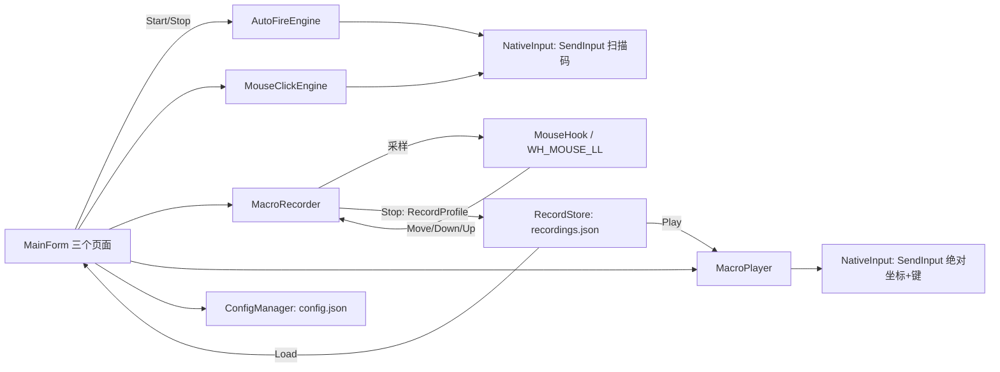
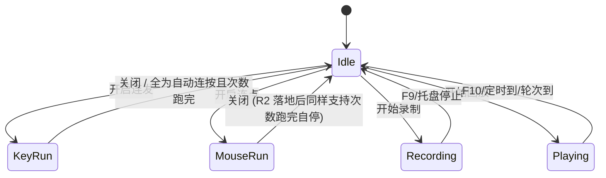

# v1.2.0 功能方案：自动连按 + 鼠标轨迹录制回放

> 状态：需求已定稿（第 13 节）　|　分支：`v1.2.0`（基线 master `181c37d`）　|　文档位置：`docs/PLAN-v1.2.0.md`
>
> 进度：
> - **P0a Tab 重构已落地**：`按键 / 鼠标 / 录制` 三个 Tab，录制页为占位。
> - **R1 自动按键已落地，设计有变更**：不再单开第 4 个 Tab「自动」，改为**按键页每行增加停止条件**「松手停止 / 自动连按 + 次数」（见第 5 节）。因此**只有 3 个 Tab**，原「`AutoActionEngine` + 自动页」方案作废。
> - R2（自动点击）、R3（录制回放）按第 10 节推进。

---

## 1. 需求拆解

| 编号 | 需求原文要点 | 关键行为 | 与现有功能的关系 |
| --- | --- | --- | --- |
| R1 | 键盘自动按键：设置 1 个或多个按键 + 间隔毫秒；启动后按间隔按个不停，或按间隔按 N 次 | **定时触发**，不需要按住任何键 | 与"按键连发"同用 `SendInput` 扫描码路径，落地为**同一引擎的另一种停止条件** |
| R2 | 鼠标自动点击：左键 / 右键 / **中键** + 间隔毫秒；一直点或点 N 次 | **定时触发**，不需要按住鼠标 | 与"鼠标连点"同一个注入函数，需补中键常量 |
| R3 | 鼠标轨迹 + 点击录制，可存多个方案（方案A/方案B…）；回放可选一个方案，回放 N 次 / 一直 / 定时 N 分钟；开始与停止都支持快捷键 | **录制**（全局鼠标采样）→ **持久化** → **时间轴回放** + 循环/定时 | 全新能力，复用鼠标钩子与 `SendInput` |

三项都属于"全局钩子 + 定时注入"的一个家族，与现有两个引擎同源，架构上不需要推倒重来。

---

## 2. 可行性结论

**三项都可行，工作量集中在 R3。** 真正的难点不是"功能做不出来"，而是下面三件事，方案里必须正面处理：

1. **触发模型差一个维度，但可以共存于同一个状态机（结论已修正）。** 最初判断"不能复用现有引擎"，实际落地后发现：每行独立选「松手停止 / 自动连按」时，两者的差别只是**这一行的 `Held` 由谁置位**——物理钩子置位，或启动时由引擎自己置位。于是复用 `AutoFireEngine` 的"按下 → 保持 → 抬起"骨架，给目标键加两个字段（触发方式、剩余次数）即可，**不再新增 `AutoActionEngine`**，也没有污染老行为（默认仍是"松手停止"）。
2. **录制是高频事件源，低级钩子扛不住"重活"。** `WH_MOUSE_LL` 回调跑在安装钩子的线程（UI 线程），系统对回调有超时限制（`LowLevelHooksTimeout`，默认 300ms），超时会被**静默摘钩**。鼠标移动可达每秒数百次，回调里不能分配大对象、不能写文件、不能碰 UI。方案：回调里只做"距离/时间过滤 + 追加到预分配数组"，落盘放到停止录制时一次性做。
3. **回放的"坐标"有两层坑。** 一是 DPI 虚化（进程 SystemAware 时挂钩坐标与 `SendInput` 绝对坐标都是物理像素，必须保持一致）；二是多显示器虚拟桌面（含负坐标，必须用 `MOUSEEVENTF_VIRTUALDESK` + `SM_*VIRTUALSCREEN` 归一化）。

另外一个必须提前说清的预期管理：**轨迹回放能否在游戏内"生效"，取决于游戏怎么读鼠标。** DNF 的攻击靠键盘边沿触发（已有 40ms 下限结论），鼠标主要用于 UI 点击与少量拖拽；如果某个场景游戏走 Raw Input / DirectInput 读相对位移，注入的绝对坐标移动可能不被采信。这部分**只能真机验证，不能靠设计保证**，方案里会给降级路径。

---

## 3. 现状盘点与改造面

### 3.1 可直接复用的资产

| 资产 | 位置 | 复用方式 |
| --- | --- | --- |
| 扫描码注入 | `NativeInput.SendKey` / `TapKey` | 直接复用 |
| 鼠标键注入 | `NativeInput.SendMouseButton(bool left, bool up)` | 扩展为 `SendMouseButton(int button, bool up)` |
| 低级钩子骨架 | `KeyboardHook` / `MouseHook` | `MouseHook` 增加 Move 事件与中键 |
| 高精度调度 | `timeBeginPeriod(1)` + `Stopwatch` + `WorkerLoop` + `Sleep(1)` | 回放/录制沿用这套骨架 |
| 自绘控件 | `AntButton / AntCheckBox / AntInput / AntNumber / AntSelect / FlatScrollBar` | 新页面全部复用，不新增控件类型 |
| 滚动容器 | `pnlContent + FlatScrollBar + WheelFilter` | 方案列表直接套用 |
| 配置 / 日志 / 托盘 / 热键 | `ConfigManager` / `Logger` / `NotifyIcon` / `RegisterHotKey` | 增量扩展 |

### 3.2 必须改的三处硬编码（P0 地基）

> ✅ 已在 `v-1.2.0` 分支落地（Tab 数组化），下表记录的是改造前后的对应关系，行号为改造前的位置。

`MainForm.cs` 原本把"只有两个 Tab"写死了，加页面必须先拆：

| 锚点 | 现状 | 改造 |
| --- | --- | --- |
| `MainForm.cs:26-31` | `_tabIndex`、`keyPage`、`mousePage` 两个字段 | 改为 `_tabIndex` + `Control[] _pages` |
| `MainForm.cs:38` | `_tabWidths = new int[2]` | `_tabWidths = new int[TabTitles.Length]` |
| `MainForm.cs:640-653` | `for (int i = 0; i < 2; i++)` + `i == 0 ? "按键" : "鼠标"` | 遍历 `static readonly string[] TabTitles` |
| `MainForm.cs:687-691` | `keyPage.Visible = idx == 0; mousePage.Visible = idx == 1;` | 循环切 `_pages[i].Visible` |
| `MainForm.cs:319-344` | `RefreshRunCard` / `RefreshStatus` 按 `_tabIndex == 1` 二分 | 改为按 Tab 查表（引擎名、按钮文案、状态文案） |
| `MainForm.cs:694-708` | `SyncHotkeyUI` 只处理按键/鼠标 | 按 Tab 查表（热键标签、第二行控件显隐、提示文案） |
| `MainForm.cs:353-363` | 关闭判断只看两个引擎 | 扩到"任一引擎运行 / 录制中 / 回放中" |

窗口高度也需要调整（见 4.4）。

### 3.3 为什么 R1 直接扩展 `AutoFireEngine`（结论已修正）

| 维度 | 松手停止（原有） | 自动连按（新增） |
| --- | --- | --- |
| 触发源 | 物理按下（钩子事件置 `Held`） | 启动时引擎自己置 `Held` |
| 停止条件 | 松手（`Held=false` 立即释放） | 次数跑完（`Remaining==0` → `Done`）/ 手动停 |
| 状态量 | `Held` + `IsDown` + `NextDue` | 同上，多一个 `Remaining` / `Done` |
| 结束时 | 回到待触发 | 该行退出排期；全部行退出则引擎自停并通知 UI |

两者共用同一条"按下 → 保持 → 抬起"的注入路径，差别只在 `Held` 的来源与结束条件，因此**扩展而非新建**：`KeyTarget` 增加 `Mode`（Hold/Auto）与 `Count`，默认值等价于原有行为。这样按键页一个引擎、一个主按钮就够，也不必为"自动"单开一页。

> R2（自动点击）同理：`MouseClickEngine` 已有「松手停止 / 点 N 次」，只需再补一个「自动连点」（见第 6 节）。

---

## 4. 总体设计

### 4.1 功能 → Tab → 引擎 → 热键

Tab 只有三个：**按键 / 鼠标 / 录制**。原计划的第 4 个 Tab「自动」已取消——自动按键变成按键页每行的停止条件，自动点击（R2）将同样处理。

| Tab | 引擎 | 触发方式 | 主按钮 | 热键（默认，可自定义并保存） | 运行中锁定范围 |
| --- | --- | --- | --- | --- | --- |
| 按键 | `AutoFireEngine` | 按住目标键（松手停止行）/ 开启后自动按（自动连按行） | 开启/关闭连发 | `F6` | 按键页配置 |
| 鼠标 | `MouseClickEngine` | 按住左/右键；R2 落地后同样支持自动连点 | 开启/关闭连点 | `F8` | 鼠标页配置 |
| 录制 | `MacroRecorder` + `MacroPlayer` | 录制按钮/`F9`；回放按钮/`F10` | 开始/停止回放 | 录制 `F9`、回放 `F10` | 方案列表 + 回放参数 |

> 一页一引擎一主按钮的形态保持不变：自动连按不是"第二个引擎"，而是同一引擎里个别行的另一套触发/停止条件，所以主按钮语义不会打架。

### 4.2 分层与数据流



职责边界：
- **UI 只负责收集参数、开关引擎、轮询状态**（不参与实时调度）。
- **引擎/播放器只做定时注入**，不碰控件、不写文件。
- **存储层只做 JSON 读写与容错**，不认识 UI。

### 4.3 运行时状态机与互斥



互斥矩阵（开始前校验，不满足则弹提示并拒绝）：

| 操作 \ 当前状态 | 连发中 | 连点中 | 录制中 | 回放中 |
| --- | --- | --- | --- | --- |
| 开始连发 | - | 允许 | 允许 | 允许 |
| 开始连点 | 允许 | - | 允许 | 允许 |
| **开始录制** | **拒绝** | **拒绝** | - | **拒绝** |
| **开始回放** | 允许 | 允许 | **拒绝** | - |

录制拒绝的理由：其他引擎会拦截物理点击/按键、或注入额外的移动与点击，录进去的方案是脏的，且用户无法分辨。

> 自动连按目标键与"物理按住"的连发行若填了同一个键，属于同一引擎内的重复配置：启动前校验直接拒绝（见 5.2），不跨引擎讨论。

### 4.4 窗口尺寸与布局

高度从 400 → **470**（宽度保持 600）。加高只为录制页（方案列表 + 录制/回放两行设置），按键页与鼠标页不需要更多高度：

> **落地偏差**：实际**没有加高**——三行鼠标配置 + 提示、录制页（列表 4 行 + 录制行 + 回放行 + 两行提示）在原有 `ClientSize = 600×400`（页面 596×258）里都排得下，所以最终只调整了页内坐标。下面的 470 布局图保留为当初的设计推演。

```
ClientSize = 600 × 470
┌────────────────────────────────────────────────────────────┐ y=2
│ 按键   鼠标   录制                v1.2.0 · 鹏多多            │ 44
├────────────────────────────────────────────────────────────┤
│   页面内容区 596 × 328（各页面叠放，只显示当前页）             │
├────────────────────────────────────────────────────────────┤ y=374 (2px 分隔)
│ [开启连发]                    │ 连发热键   [F6   ▾]        │
│ 当前控制：按键连发             │ 连发模式   [B 拦截原生 ▾]   │
│ 未开启                        │ B 模式全局拦截目标键…       │
└────────────────────────────────────────────────────────────┘ y=470
   ↑ 294 宽                         ↑ 300 宽（x=298 起，2px 竖分隔）
```

页面 328px 的空间分配：

| 页面 | 内容 | 高度占用 |
| --- | --- | --- |
| 按键 | 标题 20 + 5 行（每行含停止条件与次数框）170 + 新增按钮 40 | ≈ 250（+78 余量） |
| 鼠标 | 标题 + 2 行连点 + 提示 | ≈ 160 |
| 录制 | 标题 + 方案列表 180 + 录制行 + 回放行 + 提示 | ≈ 320（刚好） |

> 自动连按做成"行内停止条件"后，不再需要额外页面或额外高度：每行只是多了 96px 宽的下拉框与 72px 宽的次数框，行宽从 516 扩到 544 就能放下（已落地）。

同步改动：`ClientSize`、`pnlMain.Size`、页面 `Size`、两个底部面板 `Location.Y`、`OnPaint` 两条分隔线的坐标。原有按键/鼠标页内容坐标不动。

### 4.5 文件规划

| 文件 | 动作 | 内容 |
| --- | --- | --- |
| `MacroRecorder.cs` | 新增 | 录制器：钩子采样、降噪、容量上限、宽限期、生成 `RecordProfile` |
| `MacroPlayer.cs` | 新增 | 回放器：时间轴调度、循环、定时、插值、停止时释放 |
| `RecordOverlayForm.cs` | 新增 | 录制悬浮条：置顶小窗（● 录制中 + 计时 + 点数 + ■），负责排除区域上报 |
| `RecordStore.cs` | 新增 | `recordings.json` 读写 + 模型 + 版本兼容 |
| `MainForm.Record.cs` | 新增 | `partial class MainForm`：录制页构建、方案列表、录制/回放开关 |
| `NativeMethods.cs` | 修改 | 中键常量、`WM_MOUSEMOVE`、`MOUSEEVENTF_*` 绝对值/虚拟桌面、`GetSystemMetrics`、`SendInput` 批量封装 |
| `MouseHook.cs` | 修改 | 支持中键；新增 `Move` 事件（仅在订阅时回调，避免连点场景开销） |
| `AppConfig.cs` | 修改 | ✅ `KeyConfig.StopMode/StopValue`（R1 已加）；R2 再加 `MouseClickConfig.StopMode` 的 `auto` 取值；录制回放新增 `RecordHotkey` / `PlaybackHotkey` |
| `AutoFireEngine.cs` | 修改 | ✅ `KeyTarget` 带 `TriggerMode` + `Count`，自动行由引擎自己置 `Held`，跑完置 `Done` 并触发 `AllDone` |
| `MainForm.cs` | 修改 | ✅ 全部落地：Tab 化重构、按键页停止条件与键名校验、鼠标页三行与自动点击、录制页与回放行、4 个热键注册与重复校验、托盘菜单、关闭/互斥逻辑、调试入口（窗口未加高，仍是 400） |
| `Program.cs` | 修改 | ✅ 调试参数已全部加上（`--screenshot <path> record`、`--recordtest`/`--playtest`/`--movetest`/`--keytest`） |
| `README.md` / `CHANGELOG.md` | 修改 | ✅ 功能说明、配置示例、1.2.0 条目、录制页截图 |
| `dnf-autofire.csproj` | 修改 | ✅ `<Version>1.2.0</Version>` |

`MainForm.cs` 现在已经 1500 行，录制页会再涨一截。**录制页用 partial 类分文件**（`MainForm.Record.cs`），既有页面暂不拆分（避免无谓 diff），后续可另行拆成 `MainForm.Keys.cs` / `MainForm.Mouse.cs`。

> **落地偏差**：最终没有拆 `MainForm.Record.cs`——录制/回放部分在 `MainForm.cs` 内按 `// ---------- 录制 ----------` / `// ---------- 回放 ----------` 分段，独立逻辑都放在 `MacroRecorder` / `MacroPlayer` / `RecordStore` / `RecordOverlayForm` 四个文件里，`MainForm` 只留 UI 粘合。真要拆，等它超过 3000 行再说。

---

## 5. R1：自动按键（已落地）

### 5.1 交互：按键页每行加一个停止条件

不新增页面，只在原有的连发行尾部加两个控件（已实现）：

```
按键配置
[✓] 启用 [ X ] 键，间隔 [  50 ] 毫秒，[ 松手停止 ▾]                删除
[✓] 启用 [N5 ] 键，间隔 [ 100 ] 毫秒，[ 自动连按 ▾] [   0 ]        删除
[ ] 启用 [ A ] 键，间隔 [ 100 ] 毫秒，[ 自动连按 ▾] [ 200 ]        删除
＋ 新增一行
```

- 停止条件下拉两项：**松手停止**（默认，等价于原行为）/ **自动连按**。
- 选「自动连按」时右侧出现次数框：`0` = 无限次，`1–100000`，步进 100，可手输；选「松手停止」时该框隐藏（复用 `AntNumber` 的 `Min/Max/Step` 与显隐套路）。
- 行宽从 516 扩到 **544**（与鼠标页对齐），行内坐标：复选框 `(0,2) 56×28` → 键名框 `(58,3) 56×28` →「键，间隔」`x=120` → 数字框 `(184,3) 84×28` →「毫秒，」`x=274` → 下拉 `(318,2) 96` → 次数框 `(420,3) 72×28` →「删除」`(496,3) 44×26`。

**键名支持范围与校验（本轮补强）**

| 输入 | 含义 | 虚拟键码 |
| --- | --- | --- |
| `A`–`Z` | 字母键 | `0x41`–`0x5A` |
| `0`–`9` | 主键盘数字 | `0x30`–`0x39` |
| `N0`–`N9` | **小键盘数字**（在框里直接按小键盘即写入） | `0x60`–`0x69` |

- 键入层面：只放行 `A-Z`、`0-9`、`Backspace`、`Delete`；符号、空格、中文、`Ctrl+V` 粘进来的非法内容一律拦掉并给状态栏提示。
- 已有一个字符时：只有「`N` + 数字」允许追加，其它情况**用新字符整体替换**（避免出现 `X5` 这种非法组合）。
- 粘贴/手改产生非法形态（如 `AB`、`5N`）→ 立即清空并提示规则。
- 程序改写文本时用 `_keyFixing` 抑制 `TextChanged` 递归；`CharacterCasing=Upper` + 统一 `ToUpperInvariant`，保证配置里永远是大写。
- 键名框有 ToolTip 说明「支持 A-Z、0-9；小键盘数字直接按小键盘（显示为 N0-N9）」。

**开启前校验（不允许"半配置"启动）**

| 场景 | 处理 |
| --- | --- |
| 某行勾选了但键名为空 | **拒绝开启**，提示"第 N 行勾选了启用但没有填键名"，并把焦点 + 滚动定位到那一行的键名框 |
| 某行键名非法（手改配置/历史脏数据） | 同上，提示合法范围 |
| 两行填了同一个键（含 `5` 与 `N5` 这类同 VK 不同写法） | 拒绝开启，提示"第 N 行与第 M 行用了同一个键" |
| 一行都没勾选 | 提示"没有可连发的按键"，不开引擎 |
| 键名重复（输入阶段） | 实时把后填的那行置空并提示，不等到启动 |

校验逻辑收在 `MainForm.CollectTargets`（返回错误文案 + 出错行），UI 只负责弹提示与聚焦，方便用 `--keytest` 无窗口回归。

### 5.2 引擎设计（扩展 `AutoFireEngine`，未新增类）

```csharp
public enum TriggerMode { Hold, Auto }

public readonly record struct KeyTarget(int Vk, int IntervalMs, TriggerMode Mode, int Count);
//   Count 仅 Mode=Auto 时有意义：<=0 表示无限次
```

- `Hold` 行完全走原逻辑：钩子 `KeyDown` 置 `Held=true`，`KeyUp` 置 `false`，与 v1.1.0 行为一致。
- `Auto` 行在 `Start` 后直接 `Held=true`，无需物理按键；每次「按下 → 保持 → 抬起」后 `Remaining--`，归零即 `Done=true` 并退出排期。
- 全部启用行都是 `Auto` 且都 `Done` 时，引擎自行 `Stop()` 并触发 `AllDone` 事件；UI 收到后（`BeginInvoke` 回主线程）把按钮/状态栏复原并弹托盘提示。
- **只要还有一行是 `Hold`，引擎就不自动停**，避免把正在等用户按住的模式误关。
- 调度参数沿用原有经验值，不另起一套：`period = max(IntervalMs,40)`、`hold = clamp(IntervalMs/2, 20, 30)`。
- `Stop()` 统一补发抬起，避免停在"按下"状态导致卡键。

### 5.3 注意事项

| 项 | 说明 |
| --- | --- |
| 小键盘与 NumLock | 小键盘的物理按键在 NumLock 开启时上报 `VK_NUMPAD0-9`（能匹配 `N0-N9`），关闭时会上报方向键/`VK_CLEAR`，此时"松手停止"行按不出来。**自动连按行不受影响**（注入走扫描码，与 NumLock 无关） |
| 注入路径 | `NativeInput.SendKey` 用 `MapVirtualKey` 取扫描码后 `KEYEVENTF_SCANCODE` 注入，`N5` → 扫描码 `0x4C`，游戏走 DirectInput 也能识别 |
| 作用窗口 | 全局注入，作用于**当前活动窗口**，README 需写明 |
| 无限次行 | 只能手动停（按钮/热键/托盘），托盘气泡会提示按哪个热键 |

---

## 6. R2：自动点击（含滚轮/中键，已落地）

按 R1 已确认的形态落地：**不新开 Tab、不新增引擎**，在鼠标页每一行同样加一个停止条件，并把滚轮（按下=中键）补成第三行。

```
鼠标连点
[✓] 启用 左键 键，间隔 [ 100 ] 毫秒，[ 松手停止 ▾]
[ ] 启用 右键 键，间隔 [ 300 ] 毫秒，[ 自动点击 ▾] [   0 ]
[ ] 启用 滚轮 键，间隔 [ 100 ] 毫秒，[ 自动点击 ▾] [ 500 ]
提示：松手停止行按住对应鼠标键才连点；自动点击的行开启后无需按住，次数为 0 表示一直点。
```

- 下拉两项沿用按键页形态：**松手停止**（默认）/ **自动点击**；数值框同样 `0` = 无限，`1–100000`，步进 100。
- 行内文字与按键页一致去掉「按住」二字；滚轮做成固定第三行（与左/右同构），三行各自设间隔。
- 运行中锁定第三行在内的一整页配置。

### 6.1 常量补齐（`NativeMethods.cs`）

| 常量 | 值 | 用途 |
| --- | --- | --- |
| `WM_MBUTTONDOWN` / `WM_MBUTTONUP` | `0x0207` / `0x0208` | 钩子识别中键 |
| `VK_MBUTTON` | `0x04` | 键码 |
| `MOUSEEVENTF_MIDDLEDOWN` / `MIDDLEUP` | `0x0020` / `0x0040` | 注入中键 |
| `WM_MOUSEMOVE` | `0x0200` | 录制采样 |
| `MOUSEEVENTF_MOVE` / `ABSOLUTE` / `VIRTUALDESK` | `0x0001` / `0x8000` / `0x4000` | 回放定位 |

`NativeInput.SendMouseButton(bool left, bool up)` 改为 `SendMouseButton(int button, bool up)`（`1=左 2=右 4=中`），内部用字典映射 flag。**注意：`MouseClickEngine` 现有 5 处调用要同步改参数，改完必须回归连点功能。**

### 6.2 引擎扩展（`MouseClickEngine`）

与 `AutoFireEngine` 完全同构：

- `MouseClickEngine.StopMode` 由 `{ Count, Infinite }` 收敛为 `{ Infinite, Auto }`（`infinite`=松手停止 / `auto`=自动点击），与 `AutoFireEngine.TriggerMode` 同构；旧配置里的 `count` 读入后按 `auto` 处理。
- 自动行在 `Start` 时直接视为"按住"，跑完次数置 `Done`；全部自动行跑完时引擎自停并抛 `AllDone`，UI 走与 R1 相同的收尾路径。
- 自动行的物理点击**不拦截**（自动行不依赖物理按压，吞掉原生点击没有意义）；松手停止行维持原有拦截逻辑。
- 间隔上限仍是 10000ms、下限 100ms（引擎硬底 40ms 不变），与按键页的 50–5000ms 不同，注意别串值。

### 6.3 边界

| 场景 | 处理 |
| --- | --- |
| 三行都没勾选 | 提示"没有启用的鼠标连点行"，不开引擎 |
| 自动行次数为 0 | 视为无限，只能手动/热键停 |
| 与按键页的自动行同时开 | 允许，两个引擎互不干扰（各自线程与间隔） |
| 停止时正处"按下" | 统一补发抬起，避免卡住鼠标键 |
| 中键在游戏内无反应 | 中键注入走 `MOUSEEVENTF_MIDDLE*`，游戏若走 Raw Input 可能不认，属预期内，改写文案说明 |

---

## 7. R3：鼠标轨迹录制与回放

这是本期最重的一块，拆成"采—存—放"三段。

### 7.1 录制链路

```
物理鼠标 → WH_MOUSE_LL（UI 线程，极轻）
        → 过滤（时间/距离/宽限期/自窗口）
        → 追加到预分配 List<RecPoint>（lock，仅 Add）
        → 停止录制
        → 一次性生成 RecordProfile → RecordStore.Save() → 刷新列表
```

**钩子回调内只做三件事**（这是防"静默摘钩"的关键）：

1. 取 `MSLLHOOKSTRUCT.pt / time`；
2. 与上一个采样点比较：`dt < 8ms && dist < 2px` → 丢弃；`dt < 40ms && dist < 1px` → 丢弃；
3. `lock (_sync) { _points.Add(...) }`（`List` 预分配 capacity = 60000，避免扩容抖动）。

**不做的事**：不写文件、不更新 UI、不发消息、不 LINQ、不 ToString、不分配引用类型对象。

采样参数（可作为常量，v1.2.0 不暴露）：

| 参数 | 值 | 说明 |
| --- | --- | --- |
| 最小采样间隔 | 8ms | 约 125 点/秒上限，够还原手速 |
| 最小移动距离 | 1–2px | 抖动噪声过滤 |
| 启动宽限期 | 300ms | 忽略"点击开始录制"那一下 |
| 悬浮条区域 | 整块丢弃（外扩 4px） | 点■停止、拖拽悬浮条都不进录制 |
| 单次时长上限 | 10 分钟 | 到点自动停并提示 |
| 单次点数上限 | 60000 点 | 到点自动停并提示 |
| 事件类型 | Move / LDown / LUp / RDown / RUp / MDown / MUp | 滚轮本期不录 |

**注入事件过滤**：现有 `MouseHook` 已按 `LLMHF_ANY_INJECTED` 过滤，自己的注入不会被录进去——这条要继续保证（回放时若录制钩子还挂着，也不会自激）。

**录制中不隐藏窗口，改用悬浮小条**（按你的要求：能看到"录制中"的状态，又不会挡屏）：

主窗口 `Hide()` 到托盘（避免 600×470 的大窗口挡操作），屏幕上留一个**置顶的小悬浮条**：

```
┌───────────────────────────────┐
│ ● 录制中  00:03.2 · 128 点  ■ │   约 220×52，无边框、TopMost、圆角白底
└───────────────────────────────┘   右下角默认位置（离工作区边缘 24px），可拖动，记住位置
```

实现要点：

| 项 | 做法 |
| --- | --- |
| 窗体 | 独立 `RecordOverlayForm`：`FormBorderStyle.None`、`TopMost=true`、`ShowInTaskbar=false`、**不设 Owner**（设了会跟着主窗口一起隐藏） |
| 内容 | 红色圆点(闪烁) + 「录制中」+ 计时（`mm:ss.f`）+ 点数 + 「■」停止按钮；200ms 定时器刷新 |
| 拖动 | 鼠标按住窗体任意空白处移动（`WM_NCHITTEST → HTCAPTION` 或手写 `MouseMove` 偏移） |
| **排除录制** | 钩子里判断坐标是否落在悬浮条矩形（含 4px 外扩）内 → 该事件一律丢弃。这是"点■停止不会录进去"的关键。矩形在拖动后实时更新（`_overlayBounds`） |
| 点击停止 | 点■ / 按 `F9` / 托盘菜单，三条路都走同一个 `StopRecording()` |
| 结束 | 关闭悬浮条 → 主窗口 `ShowWindow()` → 托盘气泡"已保存 方案B：12.4s / 386 点" |
| 退出保护 | 悬浮条关闭（`Alt+F4` 无效，无边框窗体需自行 `ControlBox` 处理）或程序退出时先保存录制数据 |

宽限期仍保留 300ms：防止「点开始录制」的那一下以及悬浮条首帧出现前的边缘事件被录进去。有了矩形排除 + 宽限期两条保险，就不再需要"整块屏幕区域不录"的粗暴做法。

### 7.2 存储

新增 `recordings.json`（与 `config.json` 同目录，走 `AppPaths.DataDir`）。**不塞进 config.json**：方案可能上万点，会拖慢每次热键/勾选变更时的配置落盘。

```jsonc
{
  "version": 1,
  "profiles": [
    {
      "id": "8f2c1e7a",
      "name": "方案A",
      "createdUtc": "2026-11-16T10:20:00Z",
      "durationMs": 12480,
      "screen": { "x": 0, "y": 0, "w": 1920, "h": 1080 },   // 录制时虚拟桌面，用于分辨率变化提示
      "points": [
        { "t": 0,    "k": 0, "x": 960, "y": 540 },   // k: 0=Move 1=LDown 2=LUp 3=RDown 4=RUp 5=MDown 6=MUp
        { "t": 120,  "k": 1, "x": 1210, "y": 380 }
      ]
    }
  ]
}
```

- 字段名压到 1–2 字符，60k 点约 2MB，可接受；`WriteIndented = false` 只为这个文件。
- 读取容错对齐现有 `ConfigManager.Load`：解析失败 → 返回空库 + `Logger.Error`，**不覆盖原文件**（避免用户方案被静默清空）。
- `version` 预留：将来加滚轮/键盘事件时按版本升级，旧文件照读。
- 上限 **10 个方案**，超出时开始录制前提示"方案已满 10 个，请先删除旧方案"。

**方案命名**：录制结束自动取"第一个未占用的 `方案A…方案Z`，用尽后 `方案27`"。名称可在列表行内直接改（`AntInput`，失焦即存）。

### 7.3 回放链路

```
MacroPlayer.Start(profile, repeatMode, value)
  → 线程：Stopwatch 时间轴
      for each loop:
        for each point:
          等到 t（Sleep(1) 轮询，timeBeginPeriod(1)）
          Move  → SendInput(MOVE|ABSOLUTE|VIRTUALDESK)
          点击  → SendInput(按下) / SendInput(抬起)
        loop 间隔 300ms（常量 LoopGapMs）
        Count 模式：轮次 -1，为 0 结束
        Duration 模式：now - start >= N*60000 → 立即结束（允许截断在半轮）
```

细节约定：

| 项 | 规则 |
| --- | --- |
| 定位方式 | 用 `MOUSEEVENTF_MOVE` + `ABSOLUTE` + `VIRTUALDESK` 三标志组合，不用 `SetCursorPos`（不产生标准输入事件、且不同 DPI 感知下语义不一致） |
| 归一化 | `dx = round((x - vx) * 65535 / (vw - 1))`，`dy` 同理；`vx/vy/vw/vh` 取自 `SM_XVIRTUALSCREEN / Y / CXVIRTUALSCREEN / CYVIRTUALSCREEN`（多屏含负坐标，`VIRTUALDESK` 必带，误差 ±1px） |
| 平滑插值 | 相邻两个 Move 的 `dt > 32ms` 且距离 > 4px 时，按 ≤16ms 步长线性插点（对齐 60fps 轮询节奏）。可用常量开关，默认开 |
| 点击保持 | 录制的 down/up 间隔 < 20ms 时抬到 20ms（游戏帧边沿检测下限，与现有引擎一致）；不改变点击次数与相对顺序 |
| 停止 | 每个点检查 `_stop`；`Stop()` 时补发所有处于按下状态的键/鼠标键 |
| 轮次/进度 | 暴露 `Loop`、`ElapsedMs`、`ProfileName`，UI 200ms 轮询显示"第 2 轮 · 00:41" |
| 结束 | `Finished` 事件 + `Running=false`，UI 恢复按钮并弹托盘气泡 |

### 7.4 坐标、DPI、多屏

| 风险 | 说明 | 对策 |
| --- | --- | --- |
| DPI 虚化 | 进程 SystemAware 且系统缩放 125% 时，若一处用逻辑坐标一处用物理坐标就会偏移 | 全程物理像素：钩子 `pt` 本来就是物理像素；`SendInput` 绝对值在 DPI-aware 进程下也按物理像素解释。**不要引入 `Screen.PrimaryScreen.Bounds`（那是逻辑坐标）** |
| 多显示器 | 副屏在主屏左侧时 X 为负，普通 `SM_CXSCREEN` 归一化会算错 | 用 `SM_*VIRTUALSCREEN` + `MOUSEEVENTF_VIRTUALDESK` |
| 录制后改了分辨率/缩放 | 回放位置整体偏移 | 已保存 `screen` 快照；回放前若与当前虚拟桌面不一致，状态栏提示"录制分辨率 1920×1080，当前 2560×1440，回放位置可能有偏移"（仅提示，不阻止） |

### 7.5 交互（录制页）

```
鼠标录制回放
┌ 方案列表（528×180，超过 5 行滚动）────────────────────────────┐
│ [✓] 方案A   12.4s · 386 点                        删除      │
│ [ ] 方案B   03.1s ·  92 点                        删除      │
└──────────────────────────────────────────────────────────────┘
[ ● 开始录制 ]   未录制 / 录制中 00:03.2 · 128 点

回放   一直放 ▾   [   1 ] 次      已选：方案A · 12.4s

提示：录制中主窗口收进托盘，屏幕右下角留一条录制状态条；F9 开始/结束录制，F10 开始/停止回放。
```

- 方案选择：`AntCheckBox` 实现**单选**（勾一个自动取消其他），不加新控件类型。
- 名字：行内 `AntInput`，失焦或回车即存。
- 删除：行尾 `AntButton(Text, Danger)`，点击后即时删除（方案可重录，不做二次确认弹窗，但状态栏提示"已删除 方案B"）。
- 回放设置：`[模式下拉] [数值框] [单位]`，模式 = `回放 N 次` / `一直放` / `定时 N 分钟`；"一直放"隐藏数值框；N 次范围 1–9999；分钟范围 1–600，步进 1。
- 主按钮（左下）跟随 Tab：`开始回放 / 停止回放`；`lblTarget` = "当前控制：轨迹回放"。
- 未选方案点开始 → 提示"请先勾选一个方案"。
- 回放中锁定：列表（名称、勾选、删除）+ 模式/数值 + 录制按钮。
- 录制中锁定：列表全部 + 回放设置 + 主按钮置灰。

### 7.6 失败模式与降级

| 场景 | 表现 | 处理 |
| --- | --- | --- |
| 游戏走 Raw Input 读相对位移 | 回放时光标动了，游戏内视角没动 | 无解，界面提示"若游戏内无响应，说明该场景使用原始输入，回放仅在系统层生效" |
| 独占全屏 + 高权限游戏 | 注入被 UIPI 丢弃 | 程序已 `requireAdministrator`，与连发同理；仍失败则提示以管理员运行 |
| 方案被删时正在回放 | 已开始的回放持有快照 | 回放期间禁止删除（列表锁定），从根上避免 |
| 录制中切换了分辨率/显示器 | 采样坐标跳跃 | 记录 `screen` 快照，不做特殊处理，回放时给提示 |
| 托盘退出时正在录制 | 数据丢失 | `ExitApp` 前先 `StopRecording(save: true)` |
| 内存/文件异常 | 大方案写盘失败 | `try/catch` + `Logger.Error` + 状态栏红字提示，内存中的方案保留（可重试删除/重录） |
| 方案列表有 2 个以上时切换选中 | 进程直接消失（`0xc00000fd` 栈溢出，日志里没有任何 Exception 记录） | 单选互斥的实现是「点 B → 取消 A」，而 A 的回调里又会把自己勾回来、顺带取消 B，两者来回递归到栈耗尽。`_syncingSelection` 置位期间直接 return，内部同步不再触发回调；回归入口 `--seltest` |

### 7.7 回放状态条（追加需求：回放时也要看得见进度）

录制有悬浮条，回放原本只有托盘悬停提示——主窗口一收进托盘，就完全看不出在放哪个方案、放到第几次。补一条与录制对称的**只读**状态条。

```
┌────────────────────────────────────────┐
│ ● 回放中   方案A   第 2/5 次  00:03.0  │   217×44，贴工作区右下角（与录制条同一位）
└────────────────────────────────────────┘
```

| 项 | 结论 |
| --- | --- |
| 内容 | 状态点（蓝，200ms 明暗） + `回放中` + 方案名 + `第 N/M 次`（一直放只有 `第 N 次`） + 已用时 `mm:ss.d` |
| 位置 | 构造时即按 `Screen.PrimaryScreen.WorkingArea` 定位到右下角内缩 24px；**不靠 `OnShown`**，否则首帧会先在 (0,0) 闪一下 |
| 交互 | **整条鼠标穿透**（`WS_EX_TRANSPARENT` + `WS_EX_NOACTIVATE` + `WS_EX_TOOLWINDOW`）：回放时鼠标是程序注入的，状态条若能点击，轨迹正好经过就会吞掉一次点击，命中按钮甚至会把回放停掉。因此不做拖动、不做 ■，停止只保留 `F10` 与托盘菜单 |
| 刷新 | 复用主窗口已有的 200ms `_playTimer`（`UpdateProgress(轮次, 已用时, 是否被拦截)`），状态条自己不起定时器，与状态栏、托盘文案同源同帧 |
| 宽度 | 按文本实测宽度（`TextRenderer` + `NoPadding`）自适应，变化时锚定右边缘向左长；注入被拦截时整条换成红字「注入被拦截 · 请以管理员身份运行」 |
| 轮次口径 | `MacroPlayer` 新增 `CurrentLoop`（第 1 次进行中 = 1）；旧的 `Loop` 是"已完成次数"，第一轮进行中为 0，直接拿来显示会差一位，且轮间隔里会显示成上一轮次 |
| 生命周期 | `StartPlayback` 成功后在 `Hide()` 之后创建并 `Show()`；手动停止（`StopPlayback`）、自然结束（`OnPlaybackFinished`）、退出程序（`FormClosed`）统一走 `ClosePlayOverlay()` |
| 失败降级 | 状态条构造/显示异常只记 `Logger.Error("PlayOverlay")` 并置空，**不影响回放本身** |

验证：`--playoverlaytest <png>` 离屏出图并打印 `ExStyle`（确认 `WS_EX_TRANSPARENT` 真的挂上）；`--playtest … <png>` 在回放进行到第 2 次时抓真实状态条。


---

## 8. 热键与全局开关

| 热键 | 默认 | 行为 | 配置位置 |
| --- | --- | --- | --- |
| 连发热键 | `F6` | 开关按键连发（含自动连按行） | 按键页 → 设置卡第一行 |
| 连点热键 | `F8` | 开关鼠标连点（含自动连点行，R2 落地后） | 鼠标页 → 设置卡第一行 |
| 录制热键 | `F9` | 开始 / 结束录制 | 录制页 → 设置卡第一行 |
| 回放热键 | `F10` | 开始 / 停止回放 | 录制页 → 设置卡**第二行**（该 Tab 下第二行原本是"连发模式"，改为回放热键；模式行仅按键页显示） |

**4 个热键全部可自定义并保存**：沿用现有 `cboStartKey` 那套「改了就 `SaveConfig()` + 重新 `RegisterHotkeys()`」的机制，`F9 / F10` 只是默认值，同样写进 `config.json`。原计划的"自动热键 F7"随第 4 个 Tab 一起取消——自动连按由连发热键统一开关。

设置卡第二行复用策略（`SyncHotkeyUI` 按 Tab 查表）：

| Tab | 第一行 | 第二行 | 底部提示 |
| --- | --- | --- | --- |
| 按键 | 连发热键 | 连发模式 | B 模式全局拦截目标键；间隔 50-5000ms |
| 鼠标 | 连点热键 | 隐藏 | 连点热键全局开关鼠标连点… |
| 录制 | 录制热键 | 回放热键 | 录制/回放均可用热键一键开始与停止 |

**热键冲突校验（新增，必须做）**：4 个热键共用一个 F1–F12 池，现在可能重复。`SaveConfig` 前检测重复 → 拒绝保存 + 状态栏提示"热键 F6 已被连发占用，请更换"；`RegisterHotkeys` 对重复项跳过并提示。

---

## 9. 配置与兼容

### 9.1 `config.json` 增量（向后兼容，旧文件缺字段走默认值）

```jsonc
{
  "Keys": [                                       // 每行：键名 + 间隔 + 停止条件（R1 已落地）
    { "Key": "X",  "IntervalMs": 50,  "StopMode": "hold", "StopValue": 0,   "Enabled": true },
    { "Key": "N5", "IntervalMs": 100, "StopMode": "auto", "StopValue": 0,   "Enabled": true },  // 0 = 无限
    { "Key": "5",  "IntervalMs": 100, "StopMode": "auto", "StopValue": 500, "Enabled": false }
  ],
  "MouseClicks": [ ... ],                         // R2 落地后 StopMode 增加 "auto"
  "StartHotkey": "F6",
  "MouseStartHotkey": "F8",
  "RecordHotkey": "F9",
  "PlaybackHotkey": "F10",
  "Mode": "B"
}
```

- `Key` 取值：`A-Z`、`0-9`、`N0-N9`（小键盘），统一大写；读取时非法值回落为空（`SanitizeKeyText`），不会因为脏数据打不开界面。
- 老配置（1.0/1.1）缺 `StopMode` / `StopValue` → 落到 `hold` / `0`，等价于原行为，不做版本号与迁移代码。

### 9.2 三个状态面同步

进程内所有入口必须同时更新 UI（历史坑：`DebugShowMouseTab` 曾漏 `RefreshRunCard`）：

| 入口 | 必做 |
| --- | --- |
| 主按钮 | `RefreshRunCard()` + `SetXxxUiLocked()` + `RefreshStatus()` |
| 热键 `WM_HOTKEY` | 同上（不依赖当前 Tab） |
| 托盘菜单（新增录制/回放项） | 同上 + `Hide/ShowWindow` |
| 引擎自动结束（任务做完/定时到） | 200ms 定时器发现 `Running` 变 `false` → 复原 UI + 托盘气泡 |
| 关闭窗口 / 退出 | 依次 `Stop` 所有引擎 + `StopRecording(save:true)` + `StopPlayback` |

托盘菜单建议：

```
显示窗口
────────────────
开始录制 / 停止录制      （文案随状态变）
开始回放 / 停止回放      （未选方案时置灰）
────────────────
退出程序
```

---

## 10. 实施计划

| 阶段 | 内容 | 产物 | 验收标准 |
| --- | --- | --- | --- |
| **P0a Tab 重构（已完成）** | Tab 数组化：`TabTitles` + `Panel[] _pages`，三页叠放；`RefreshRunCard` / `SyncHotkeyUI` / `ToggleCurrentEngine` / `SaveConfig` 全部改为按 Tab 查表；录制页占位（标题 + 说明，主按钮「开始回放」置灰、录制热键 F9 只展示不可编辑）；`DebugShowTab(int)` + `--screenshot … record` | 按键 / 鼠标 / 录制 三 Tab | 旧功能行为不变（对照截图一致）；`--screenshot … mouse` 正常 |
| **P1a R1 自动按键（已完成）** | 按键页每行加「松手停止 / 自动连按」+ 次数框；`AutoFireEngine.KeyTarget` 加 `TriggerMode`/`Count`，自动行自置 `Held`、跑完置 `Done`、全自动行跑完自停并通知 UI；行宽 544 | 可用的 R1 | 次数到点自动停；无限次手动停；混合松手行不会误停；停止不卡键 |
| **P1b 键名校验（已完成）** | 键名支持 `A-Z` / `0-9` / 小键盘 `N0-N9`；非法输入拦在键入层；勾选行空键名/非法/同键一律拒绝开启并定位到该行；`--keytest` 无窗口回归 | 输入健壮性 | 空键名启用行无法开启；`5` 与 `N5` 视为不同键；小写/脏配置自动归一 |
| **P0b 布局地基（已完成）** | 窗口 400 → 470、页面 596×328、底部分隔线 Y 位移、常量补齐、`SendMouseButton` 改签名 | 加高后的壳子 | 各页在 328 高度下不溢出；连点回归通过 |
| **P2 R2 自动点击（已完成）** | 鼠标页每行加「自动点击」+ 次数；滚轮（中键）第三行；中键常量与 `SendMouseButton(int,bool)` | 可用的 R2 | 左/中/右三键各测；次数到点自停；与按键页自动行可同时开 |
| **P3 录制（已完成）** | `MouseHook` 扩展（Move/中键 + 坐标时间戳）、`MacroRecorder`、`RecordStore`（`recordings.json`）、录制页方案列表（单选/改名/删除）、`RecordOverlayForm` 悬浮条、`F9`、托盘项 | 可录制、可管理方案 | 录 3 个方案、重启后还在；高频移动不掉点、不被摘钩；悬浮条区域不进录制 |
| **P4 回放（已完成）** | `MacroPlayer`（循环/定时/插值/停止释放）、`F10`、录制页回放设置行、`RefreshRunCard` 联动、`--playtest`/`--movetest` | 完整 R3 | N 次/一直/定时三种模式正确；停止立即生效；多屏与 125% 缩放位置准确 |
| **P5 打磨发版（已完成）** | 真机复测、文案/README/CHANGELOG、截图（`docs/screenShot_3.png`）、`Version=1.2.0`、tag | v1.2.0 | 各项功能同时可开不互相干扰；托盘/热键/配置全通 |

每阶段的"验收标准"就是提测清单。P0a / P0b / P1a / P1b / P2 / P3 / P4 / P5 已全部落地（`v1.2.0` 分支，`<Version>1.2.0</Version>`）。

> 实际落地与计划的差异：窗口没有加高到 470 —— 三行鼠标配置 + 提示在原有 400 高度里排得下（`RecListHeight=120` 正好 4 行），所以只调整了页面内坐标；录制页的回放设置压在录制行下方一行（模式 / 数值 / 已选方案），底部提示拆两行。
>
> 发版前追加的两项（原计划没有）：① **回放间隔** —— 两轮之间的等待，默认 1000ms、0–999999、步进 1，存在 `PlayGapMs`，由 `MacroPlayer.Start(profile, mode, value, gapMs)` 传入；② **关闭确认** —— 点 X 走 `WM_SYSCOMMAND + SC_CLOSE` 拦截（不是 FormClosing，因为程序自己 `Close()` 与用户点 X 的 CloseReason 并不可靠），弹 `ClosePromptForm` 二选一，选最小化则 `Hide()`。
>
> 回放的两点实现取舍：① 插值只针对「移动→移动」相邻点（点击前若坐标不符只补一次定位，不做插值，避免点击被延后）；② 定时模式按绝对时间判断，允许在半轮处截断（不补齐当前轮）。

---

## 11. 测试计划

**自动按键（已可测）**：两行不同间隔同时跑 / 每行独立「自动连按 N 次」各自到点退出 / 全部退出后引擎自动停 / 单行按 3 次即停 / 次数 0 无限后手动停 / 间隔 50 与 5000 / 停止时正处按下态（不卡键）/ 混合「松手停止」行时不会误停 / 新增行到 5 行上限后按钮置灰 / 删除到剩 2 行不能删 / 运行中配置锁定。

**键名校验（已可测）**：`A-Z` / `0-9` / 小键盘各输一个（显示 `N0-N9`）/ 输入符号与中文被拦 / 已有 `X` 再输 `5` 变成 `5`（整体替换）/ `N` 后接数字得到 `N5` / 小写 `n5` 归一为大写 / 粘贴 `AB` 被清空 / 勾选但空键名点开启被拒并定位该行 / 两行同键被拒 / `5` 与 `N5` 同时存在不冲突 / 旧配置脏值回落为空 / 重启后回显。

**自动点击（R2 落地后）**：左/右/中三键各测 / 自动连点 5 次即停 / 0 次无限 / 与按键页自动行同时开（各自间隔独立）/ 中键在浏览器（新标签页）与游戏内验证 / 停止释放不卡键。

**录制**：`F9` 起停 / 按钮起停 / 主窗口收托盘 + 悬浮条出现 / 悬浮条拖动后排除区域跟着变 / 点悬浮条■停止（该次点击不进录制）/ 快速画圈（点数与降噪是否符合预期）/ 含左键、右键、中键各一次 / 10 分钟上限自动停 / 60000 点上限自动停 / 录制中按 `F9` 停止不丢点 / 其它引擎运行时拒绝录制 / 方案满 10 个拒绝开录 / 列表滚动、改名、删除、单选互斥 / 重启后方案仍在 / 损坏的 `recordings.json` 不覆盖原文件。

**回放**：N 次（2 次）/ 一直放后手动停 / 定时 1 分钟自动停（记录实际时长误差 ≤1s）/ 停止后光标位置与按下状态正常 / 回放中列表锁定 / 未选方案点开始被拒 / 多屏（副屏在左，负坐标）/ 125% 与 150% 缩放 / 4K 与 1080p 混用 / 录制后改分辨率有提示 / 回放中按热键立即停 / 连续启停 10 次不泄漏线程。

**并发与稳定性**：连发（含自动连按）+ 连点同时开跑 10 分钟 / 托盘退出时录制中能保存 / 关闭窗口时运行中隐藏到托盘 / 单实例保护仍有效 / 全程 `error.log` 无新增异常。

**调试入口扩展**（沿用现有 `--screenshot` / `--enginetest` 风格）：

| 参数 | 用途 |
| --- | --- |
| `--screenshot <path> [n] mouse\|record` | 各页离屏截图（均已可用） |
| `--keytest` | ✅ 已加：无窗口跑一遍开启前校验，打印 `OK targets=… vks=[…]` 或 `BLOCK: 原因` |
| `--playtest <方案名> <值> [count\|infinite\|duration] [最长秒数]` | ✅ 已加：按指定模式回放，跑完或到点即退出；配 `DNF_DRYRUN=1` 只跑时间轴 |
| `--movetest <x> <y>` | ✅ 已加：注入一次绝对定位，日志回报 `SendInput` 返回值与光标实际落点 |
| `--recordtest <ms>` | ✅ 已加：自动开录 → 抓悬浮条 → 停止落盘，验证录制链路 |

> 注意：`DrawToBitmap` 抓不到 `AntSelect` 的覆盖层（下拉框边框/箭头），这是既有渲染限制（v1.1.0 同样如此），**验证下拉框外观要用 `--uitest` 的 `PrintWindow` 路径**，别被离屏截图误导。

---

## 12. 本期不做（明确范围边界）

- 滚轮录制/回放、键盘事件录制（本期只按需求做"鼠标轨迹 + 点击"）
- 多方案同时回放、方案拼接、片段剪辑
- 变速回放（0.5x/2x）、单步调试、轨迹可视化编辑器
- 相对窗口坐标（窗口移动后仍能对齐）——需要额外记录窗口句柄与偏移，留到后续
- 方案云端同步/导入导出
- 把两个老引擎合并进统一调度器（收益低、回归风险高）
- 独立的「自动执行」页面 / `AutoActionEngine`（已改为按键页、鼠标页的行内停止条件）

---

## 13. 已定 / 待确认

**已定（本版方案已按此调整）**

| 项 | 结论 |
| --- | --- |
| 自动按键 | 像连发页一样**每键独立间隔、多行**；停止条件做成行内下拉（松手停止 / 自动连按 + 次数），**不单开 Tab** |
| 键名范围 | `A-Z`、`0-9`、小键盘 `N0-N9`；勾选行键名为空/非法/同键 → 拒绝开启 |
| 回放方案 | **单选**（勾一个） |
| 录制时的窗口 | 主窗口收托盘，屏幕上留**置顶悬浮小条**显示录制中，不再整窗隐藏 |
| 热键 | 默认 F6 连发 / F8 连点 / F9 录制 / F10 回放，**全部可自定义并保存配置** |
| 窗口高度 | 400 → 470（实际未加高：三行鼠标配置与提示在原 400 内排得下，见 §10 备注） |
| 方案上限 | **10 个**；单次 10 分钟 / 6 万点 |
| Tab 顺序 | 按键 / 鼠标 / 录制（已实现，不再增加第 4 项） |

**原待确认项（v1.2.0 已按下列方式落地）**

| 项 | 落地结果 |
| --- | --- |
| 自动点击的行形态 | 采用「左 / 右 / 滚轮 三行 + 行内停止条件」：三行都可单独切成「自动点击」，次数 `0` = 一直点；全部行都为自动点击时才在次数跑完后整体自停 |
| 悬浮条细节 | 236×44、右下角起、可拖动，显示红点 + 计时 + 点数 + ■；**未做暂停/继续与最小化圆点**，留作后续 |
| NumLock 关闭时的小键盘 | 保留限制：`N0-N9` 在 NumLock 关闭时按不出来（自动连按行不受影响），不额外做方向键映射——映射会与真方向键冲突 |
| 行数上限 5 → 7 | 不做：窗口未加高，5 行是 328 高页面内的实际上限 |

---

## 14. 界面文案与单位微调（追加需求）

| 需求 | 落地方式 |
| --- | --- |
| 不再显示「517 点」这类采样点数 | `RecordProfile.Summary` 只留时长（`12.4s`）；`RecordOverlayForm` 去掉「· N 点」并把浮条从 236 收到 200 宽、■ 左移；录制页底部提示去掉「60000 点」 |
| 去掉「（可拖动）」「（回放时把游戏切到前台）」 | 录制页提示保留「状态条 + 单次上限 10 分钟」，热键与间隔说明照旧；拖拽能力本身不变 |
| 回放间隔单位改为秒 | 界面 `间隔 [1] 秒`（0–999999，步进 1）；`MacroPlayer.Start` 改为接收 `gapSec`，内部再乘 1000 交给毫秒时间轴；配置字段 `PlayGapMs` → `PlayGapSec`，旧字段忽略并回落 1 秒 |
| 方案名输入框左右各 8px | `AntInput.TextInset`（默认 1px，setter 内立即重排），方案名输入框设为 8 |
| 连发模式改名「保留原生 / 拦截原生」 | 下拉选项去掉 A/B 前缀，顺序按「保留原生、拦截原生」，默认仍是拦截原生（索引 1）；配置里的 `Mode` 仍写 `A`/`B`，映射改为 `index==0 → A` |
| 说明文字跟随选项 | `lblModeTip` 改为 `ApplyKeyModeTip()` 动态生成：保留原生＝放行物理按键、拦截原生＝拦下物理按键 |
| 间隔范围挪到标题行 + 标题加大 | 「按键配置」字号 9.5 → 10.5，后面接 8pt 灰字「间隔范围 50-5000ms，步进 1」，位置用 `RowTextSize` 实测宽度顺排，避免不同 DPI 下压字 |
| 按键间隔步进 1 → 50 | `KeyStepMs = 50`；范围文案由常量拼出（`间隔范围 50-5000ms，步进 50`）。手输仍允许 1ms 粒度，只有上下按钮/↑↓ 按 50 走 |
| 鼠标页标题与按键页统一 | 抽 `AddPageTitle(page, 标题, 范围文案)`，两页共用 10.5pt 标题 + 8pt 灰字；鼠标页范围用 `MouseMinMs/MouseMaxMs/MouseStepMs` 拼出「100-10000ms，步进 100」；页底提示删掉间隔范围与「游戏内有效下限 40ms」 |
| 配置版本字段 `ConfigVersion` | 值＝写盘时的程序版本（`Assembly.GetName().Version.ToString(3)`）。字段不给初始值，否则 STJ 反序列化缺失属性时保留默认值，永远判不出"没有这个字段"。**后续版本把它从「判定重置」改成「只作日志与升级依据」**（见下一行） |
| 配置加载：整份重置 → 安全合并 | 以 `AppConfig.Default()` 序列化后的**形状**为骨架逐字段合并：文件里有且类型对得上 → 保留用户值；缺失 / 类型不符 → 用默认值；默认配置里没有的键（已废弃字段）不复制，回写时自然消失。合并后统一 `Sanitize`：间隔、次数、回放值按 `Limits` 钳制，热键非 F1–F12 回落默认，`Mode`/`PlayMode`/`StopMode` 归一，鼠标行固定按 L/R/M 对齐补齐，按键行最多 5 行 |
| 合并的两个坑 | ① `JsonValueKind` 把 `true`/`false` 拆成 `True`、`False` 两个值，直接比 `GetValueKind()` 会把合法布尔值判成类型不符 → 加 `KindMatches` 专门放行布尔；② 默认值为 `null` 的字段（`ConfigVersion`）在骨架里是 `null`，需要单独走"沿用文件值"分支，否则每次加载都会把它丢掉并记一次"非法值回落" |
| 旧字段 `PlayGapMs` → `PlayGapSec` | 合并前先跑 `MigrateLegacy`：文件里没有 `PlayGapSec` 但有 `PlayGapMs` 时换算成秒（`(ms+500)/1000`），日志留一条迁移记录 |
| 自动点击次数框步进 | `Step` 1、默认 `1`、范围 `0–99999`（0 = 无限），数字框后补「次」单位；单位与次数框一起显隐（松手停止时都隐藏）。`Limits.MouseCountMax = 99999`，与按键连按（`Limits.KeyCountMax = 100000`）分开 |
| 鼠标页底部说明拆三行 | 一个 `Label` 自动换行在窗口变窄时会折行数，改成三条独立 `Label`（y = 168 / 187 / 206，8pt 灰字）：松手停止 / 自动点击 / 滚轮＝滚轮按下（中键） |

---

## 附：关键改动锚点速查

> 全部阶段已落地，函数/字段名比行号稳定，按名字找。

| 位置 | 状态 | 说明 |
| --- | --- | --- |
| `MainForm.TabTitles` / `_pages[]` / `DebugShowTab` | ✅ 已完成 | Tab 数组化，加页 = 数组加一项 + BuildUi 加一行构建调用 |
| `MainForm.AddRow` / `RowControls` / `ApplyKeyStopMode` | ✅ 已完成 | 行内停止条件（松手停止 / 自动连按 + 次数框） |
| `MainForm.CollectTargets` | ✅ 已完成 | 开启前的键名收集与校验（空 / 非法 / 同键） |
| `MainForm.KeyBox_KeyPress` / `KeyBox_KeyDown` / `KeyBox_TextChanged` | ✅ 已完成 | 键名输入拦截、小键盘 `N0-N9`、去重 |
| `MainForm.KeyTextToVk` / `SanitizeKeyText` | ✅ 已完成 | 键名 ↔ VK 映射（含小键盘）与脏值归一 |
| `AutoFireEngine.KeyTarget` / `AllDone` | ✅ 已完成 | 触发方式 + 次数；全自动行跑完自停 |
| `MainForm.BuildUi` 里 `ClientSize` / `pnlMain` / 页面 `Size` / 底部分隔线 Y | ✅ 定稿 | **保持** `ClientSize` 600×400、页面 596×258（未按 470 加高，见 §10 备注） |
| `MainForm.BuildMousePage` / `ApplyMouseStopMode` | ✅ 已完成 | 左 / 右 / 滚轮三行 + 「松手停止 / 自动点击」+ 次数框 |
| `MainForm.WndProc`（`WM_HOTKEY`） | ✅ 已完成 | 4 个 ID：1 连发 2 连点 3 录制 4 回放 |
| `MainForm.SaveConfig` / `LoadConfigToUi` | ✅ 已完成 | `Keys[].StopMode/StopValue`、`MouseClicks[]`、`RecordHotkey` / `PlaybackHotkey` / `PlayMode` / `PlayValue` 全量读写 |
| `MainForm.RegisterHotkeys` / `UnregisterHotkeys` | ✅ 已完成 | 注册/注销 4 个热键 + 同名键只注册一次并提示重复项 |
| `MainForm.BuildTray` | ✅ 已完成 | 托盘菜单含开始/停止录制、开始/停止回放；悬停提示随状态变化 |
| `MainForm.WheelFilter` | ✅ 已完成 | 作用于当前 Tab 的滚动区（方案列表 / 按键行区） |
| `NativeMethods` | ✅ 已完成 | 中键常量、`WM_MOUSEMOVE`、`MOUSEEVENTF_MOVE/ABSOLUTE/VIRTUALDESK`、`GetSystemMetrics` |
| `NativeInput.SendMouseButton` / `SendMouseMoveAbsolute` | ✅ 已完成 | 改为 `(int vk, bool up)` 与绝对定位，返回 bool 以暴露注入失败 |
| `RecordStore` / `MacroRecorder` / `MacroPlayer` / `RecordOverlayForm` | ✅ 已完成 | 方案存储、录制、回放、录制悬浮条 |
| `PlayOverlayForm` / `MacroPlayer.CurrentLoop` | ✅ 已完成 | 回放状态条（穿透只读）+ 当前第几次 |
| `Program.cs` | ✅ 已完成 | `--screenshot`（含 `mouse`/`record`）、`--uitest`、`--keytest`、`--recordtest`、`--playtest`（含状态条截图）、`--playoverlaytest`、`--movetest`、`--mouselayout`、`--mousetest` |

